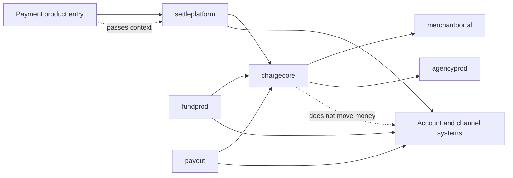
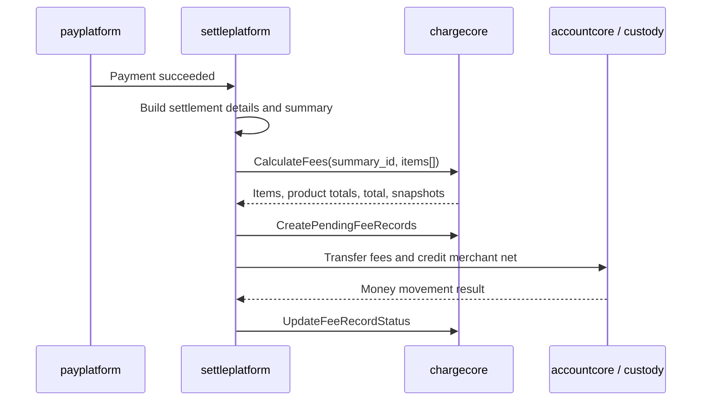

# Fee Management and Billing: Cross-System Impact Assessment

This document scopes **business systems consuming ChargeCore**. The construction of `chargecore`, `payadmin`, `merchantcore`, and the Merchant Portal fee-query page belongs to the main technical design. It asks which business systems must integrate, how they currently obtain rates and record results, and whether the proposed ChargeCore model supports the migration. It records code and production-data observations alongside proposed changes and acceptance checks; proposed changes are not reported as completed deliveries.

Decimal handling belongs in ChargeCore. Historical rounding differences below identify migration and test risks, not rounding policies that each consumer should reproduce. Consumers should use the items and totals returned by `chargecore.CalculateFees`.

## 1. Ownership by Charge Timing

| Timing or role | System | Boundary |
| --- | --- | --- |
| T+1 charge execution | `settleplatform` | Payment product and channel fees are calculated during settlement. `paymentprod`, `payplatform`, `commerce`, and `shopify` pass context rather than charge directly. |
| Realtime charge execution | `fundprod` | On/off-ramp and withdrawal cases need fee results for quotes, holds, net proceeds, and fee records. FX-spread product fees retain their existing rate source. |
| Realtime charge execution | `payout` | Batch payouts need fees at create, submit, and completion to size holds, transfer service fees, and settle successful items. |
| Result consumer | `agencyprod` | Reads completed ChargeCore fee records as a possible commission revenue source; it does not calculate a merchant fee. |

Adjacent systems remain important without becoming the charge executor. `paymentprod` owns Payment Link, Invoice, and Subscription semantics; `payplatform` owns payment sessions and orders; commerce connectors supply store/channel context. `merchantportal` can display estimated fees and a separate fee-query page. `accountcore` performs holds, debits, and credits; `chaincore`/`channelcore` execute channels and provide cost lineage; `exchangerate` remains the FX-spread source; and legacy `billprod` remains a file/old-bill system, not the transaction-level fee fact source. Payroll had only a reserved configuration in the PRD and was excluded from existing-system impact analysis.

## 2. ChargeCore Contract and Fee-Record Granularity

The proposed main path for `settleplatform`, `fundprod`, and `payout` was **calculate, create pending records, execute the actual money movement in the business system, then mark records succeeded or failed**. On/off-ramp FX-spread product fees are an exception to calculation: `exchangerate + fundprod` produces their values, but they still use the same record lifecycle.

`CalculateFees` takes merchant, product, amount, currency, timing, source-business identity, and channel context; it returns matched fee items, total, and rule/quote snapshots. Idempotency should identify a fee by `source_system + source_biz_type + source_biz_id + source_event_id + fee_category + fee_item + fee_channel`, or an equivalent business key. `source_biz_id` is the main business order; `source_event_id` is the charging event. They can normally coincide, but T+1 payment settlement should use `settlement_detail.id` as event ID to distinguish individual settled payments.

Configuration-level fixed fees and amount conditions are priced in USD. A record's `base_amount_currency` and `fee_currency` describe the actual business and charged currencies, such as USD, USDT, or USDC. ChargeCore rounds percentage components **up in the smallest currency unit**; fixed components enter at configured value. Business systems must not locally recalculate or overwrite the returned result. Channel rules match on `product_code + fee_item + conditions`; this release needed channel and transaction amount context, with `source_biz_type` reserved as a later condition. The payadmin UI permitted one channel condition and one amount expression per rule, storing a range as `gte + lte`.

Three configuration models were intended for MongoDB; `transaction_fee_record` remained in MySQL. That record's grain is **one fee item**, not one transaction. One business event can produce several records. `chargecore` decides which fees apply, their amounts, totals, and source. The business system decides when to hold, debit, credit, release, and compensate. External queries normally consume only succeeded fee results.

| Business event | Example items | Timing / executor |
| --- | --- | --- |
| Normal payment, Payment Link, Invoice, or Subscription settlement | Product fee, risk-control fee, conditional platform/channel fee where applicable | T+1 / `settleplatform` |
| Successful Payouts | Product fee and risk-control fee | Realtime / `payout` |
| On-ramp conversion | FX-spread product fee | Realtime / `fundprod` |
| Fiat off-ramp | FX-spread product fee and OSL bank fee | Realtime / `fundprod` |

FX-spread product fees stay in the `exchangerate + fundprod` rate path, but are recorded for unified results with `fee_source_ref_type=exchange_rate_quote`. They should be hidden from the merchant bill through query policy, not an extra visibility column on the physical record. `agencyprod` may read the results, but decides itself which categories count toward commission; ChargeCore does not compute commissions.

## 3. T+1 Settlement: `settleplatform`

The settlement system knows which payments are being settled. ChargeCore would determine the fees, while `settleplatform` retained pipeline orchestration, merchant net credit, and fee transfer. The proposed sequence was to synchronize payment-success facts, create `settlement_detail` and `settlement_summary`, call `CalculateFees` in `FEE_CALC`, create pending fee records before account movement, and update them after actual movement succeeds or fails.

The code and production sample explained several constraints. `settlement_detail` is transaction-level and has merchant, payment, trade, product, received amount, currency, chain, method, and channel fields, so it is a suitable per-item fee input. `settlement_summary` groups by merchant, settlement date, chain, and currency; it is the batching and pipeline boundary, not the only fee-record grain. The existing charging module already calculated per detail after `FeeCalculationRequested`, using a merchantcore fee configuration and a local percent-plus-fixed formula. The migration would replace that calculation node with ChargeCore rather than add an unrelated stage.

Historical payment, Payout, and spread code had used different rounding approaches. Tests therefore need to ensure old local calculations do not override ChargeCore amounts. `settlement_detail.fee_amount` was often zero in the observed production data, while actual fees appeared in `settlement_summary.payment_fee_amount` and pipeline output; new fee records cannot simply copy the detail field. Payment, invoice, and payment-link product codes existed. Subscription identification and store/channel context for conditional fees needed confirmation.

### Anonymized Production Sample and Acceptance Meaning

The source checked real production rows on June 4, 2026. Merchant and row identifiers are anonymized here and in the Chinese article; numbers and state relationships remain the observed sample.

| Stage | Record | Amount observation | State |
| --- | --- | --- | --- |
| After realtime aggregation, before daily settlement | Summary for merchant A, BSC/USDT | Gross `50000`, fee `0`, net `50000` | `pending` |
| Same stage | Detail under that summary | Amount/received `50000`, fee `0`, empty fee snapshot | `status=4` |
| After daily settlement | Summary for merchant A, BSC/USDT | Gross `1000`, fee `10`, net `990` | `completed` |
| Same stage | Detail under completed summary | Amount/received `1000`, fee `0`, empty fee snapshot | `status=4` |
| Same stage | Settlement pipeline | `flow_type=custody`, `current_step=BALANCE_UPDATE`, retry count `1` | `COMPLETED` |

Other completed summaries in the sample included TRON/USDT with one payment and gross/fee/net `51744/776/50968`; BSC/USDT with five payments and `18637/148/18489`; SOLANA/USDC with one and `100/1/99`; and BSC/USDT with six and `1716/17/1699`. The observed accounting relationship was `payment_net_amount = payment_gross_amount - payment_fee_amount` at summary level.

After integration, `transaction_fee_record` should supply the missing transaction-level fee items, source references, rule snapshots, and product/channel split. `CalculateFees` must return complete `fee_components` even if the caller first uses only totals. T+1 `fee_date` should preserve the existing settlement-date semantics. The sample's refund fees were zero; the proposed change still would not call `CalculateFees` for refund details.

The useful investigation queries were `settlement_summary` by completed status and settlement date; `settlement_detail` by summary ID; `settlement_pipeline` by summary ID; and `settlement_pipeline_step` by pipeline ID. The pipeline sample ended at `BALANCE_UPDATE` with `COMPLETED`, supporting the conclusion that calculation and balance update had finished.

### Proposed Calls and Record Shape

`settleplatform` would call `CalculateFees` once per summary at `FEE_CALC`, passing per-payment details for one merchant. Before actual transfer/credit it would call `CreatePendingFeeRecords`; after execution it would call `UpdateFeeRecordStatus`. It would keep the existing settlement pipeline, ensure product/business/store/channel context reaches the fee call, and retain returned item snapshots for eventual fee records.

A request item would contain `source_biz_type=payment_session`, payment ID, `source_event_id=settlement_detail.id`, product code, amount and currency, and context such as trade ID, order source, chain, payment method/channel, and wallet code. It should use `amount_received` when present, otherwise `amount`; refunds should follow the existing skip or reversal path. Cross-merchant summaries, if introduced later, would require separate requests per merchant. A response would carry `total_fee_amount`, `fee_amount_by_product`, and each item's fee components with category, item, amount, source-reference type and version. One example split a total `0.35 USDT` into `0.25` product fee and `0.10` risk-control channel fee.

Expected fee rows illustrated separate product, risk-control, and conditional platform fees for one payment event, each with the same payment and settlement-detail identity but distinct `fee_category`, `fee_item`, `fee_channel`, source reference, and snapshot. The example used a 1% product fee of `10.00` on `1000.00`, a fixed risk fee of `0.10`, and a 0.25% conditional platform fee of `2.50`. Review examples show display units; persistence uses `bigint + currency` in minor units. The open T+1 questions were whether Subscription reliably maps to `product_code=subscription` rather than Invoice, and whether settlement can obtain all Shoplazza/Shopyy/exchange channel context.

## 4. Realtime Funding: `fundprod`

For on-ramp, `fundprod` obtains the merchant FX quote from `exchangerate`, records a pending fee, executes conversion, calculates the **actual** spread revenue, then updates the fee record. The product fee is embedded in the FX spread, not calculated by the normal ChargeCore product-fee configuration. Existing `fiat_deposit` logic wrote `FundOperationRecord.PlatformSpreadRevenue` after completion, so recognizing the final result at execution time matched the current facts.

For fiat off-ramp, `fundprod` would obtain an FX quote, call ChargeCore for configurable channel fees before withdrawal, create pending records, perform holds and channel withdrawal, then update records using actual FX spread and OSL bank fee. An existing `ChannelFeeSnapshot` and payout-result fee showed a channel-fee concept already existed; configuration and calculation were to move to ChargeCore. The release target in the source was an OSL bank fee of **USD 35 per transaction**, not a new rate for every channel.

Crypto stablecoin withdrawal had `domain/withdraw.CalculateFee` returning zero in the then-current code. Gas/network cost is not automatically a merchant fee, and this scope did not add a risk-control charge to that flow. Any future fee would require separate ChargeCore configuration and records. `fundprod` still owned holds, releases, channel execution, and completion events; ChargeCore would not perform withdrawal money movement.

| Call | Point in flow | Role |
| --- | --- | --- |
| `CalculateFees` | Before quote/create/execute where applicable | Return channel/risk fees, total, and snapshot for display and hold sizing; not used for on-ramp FX spread |
| `CreatePendingFeeRecords` | Before actual funding/withdrawal execution | Establish pending result records |
| `UpdateFeeRecordStatus` | After actual outcome | Mark succeeded or failed; attach final amounts and evidence |

The proposed off-ramp request identified `source_system=fundprod`, realtime timing, USDT fee currency, `fiat_offramp_payout`, withdrawal ID, product `off_ramp`, base amount/currency, FX quote, OSL channel, source and target currencies, and fee mode. Example result records separated an on-ramp FX-spread product fee, an off-ramp FX-spread product fee, and an off-ramp `channel_service_fee` bank fee of `35.00 USDT`. The spread rows referenced `exchange_rate_quote` and were excluded from merchant billing; the bank-fee row referenced `channel_service_fee_rule` and was billed. Whether chain gas/network costs belonged in unified fee records remained open (`Q-FUND-004`).

## 5. Realtime Batch Payout: `payout`

The observed batch flow already stored fee rate, fixed fee, service-fee amount, and debit amount on the batch, plus service-fee amount per item. The Portal had a batch-level local estimate. Funds were held using `debit_amount = total_amount + service_fee_amount`; final service-fee transfer used `SettledServiceFeeAmount + FixedFee`, with `SettledServiceFeeAmount` summing successful items only. The old batch creation read `merchantcore.GetFeeConfigByDate(product_code=payouts)` and had a default fallback. The proposed migration removed local and merchantcore recalculation from the final fee decision.

At create or modify time, `payout` would call `CalculateFees` with a top-level `payout_batch` item and `fee_allocation_items[]` for valid recipients. ChargeCore would allocate the percentage product fee **per item**, using `ceil(item_amount * percentage_rate)`, and return each amount. Each item's `service_fee_amount` would contain its percentage fee plus any matched `risk_control_fee`. A product fixed fee would be charged **once per batch**, stored in `payout_batches.fixed_fee`, not allocated to items. Portal would display the backend estimate rather than a hard-coded formula.

At submit, hold the amounts and estimated fees for all valid items plus the batch fixed fee. Create pending fee rows for the batch fixed fee and each item's percentage/risk fees. After item execution, charge item fees only for successful items; failed item amounts and item fees are released. Set the batch fixed-fee row to succeeded and item rows to succeeded or failed according to outcomes. The source specified `source_biz_type=payout_batch`, `source_biz_id=batch_id`; the fixed fee uses `source_event_id=batch_id`, while item fees use `source_event_id=payout_item.id`.

The example allocation was a `1000.00 USDT` batch with item bases `100.01` and `899.99`. On the first item, a 0.10% percentage fee rounds up to `0.11`, a risk-control item adds `0.10`, and one batch fixed fee is `3.00`. The intended acceptance checks were: ChargeCore called on create, modify, and submit recheck; item service fee equals ChargeCore percentage plus risk result rather than local banker's rounding; only successful-item fees enter `SettledServiceFeeAmount`; `FixedFee` holds only the batch product fixed fee; and fee records distinguish batch and item event IDs.

## 6. Commission Consumer: `agencyprod`

`chargecore` would expose a query for succeeded fee records filtered by merchant, charge period, category, currency, and business origin. A record should include ID, merchant, product, origin IDs, fee category/item/channel, amount/currency, and `charged_at`, with source reference and snapshot available for audit.

`agencyprod` would retain agent configuration, merchant bindings, existing commission execution, and its own result tables. It would gradually move its revenue fact source from `settlement_summary.payment_fee_amount` to ChargeCore's fee-record list or aggregate. It would decide which completed merchant fees are commissionable and calculate the commission itself. The existing implementation was split across `stablepay-agencyprod` for master data/configuration and `stablepay-settleplatform/modules/agency` for execution, summaries, details, rewards, and account credit; the domain was still discussed as `agencyprod`.

## 7. Adjacent Systems and Model Fit

Upstream payment products must preserve product identity through settlement, particularly so Subscription is not priced as Invoice. `payplatform` must expose payment/order context, and commerce connectors must carry channel or store origin for conditional rules. Merchant Portal should show backend estimates and read the new query in its separate fee page; `billprod` remains a legacy bill/download route. `accountcore`, chain/custody, and `channelcore` provide execution and cost lineage but do not own merchant fee rules.

The assessed ChargeCore model could express multiple fee records for one event, T+1 and realtime timing, separate product and channel fees, merchant-specific product configuration, standard fallback packages, condition arrays for channel and amount, FX-spread provenance through quote references, and succeeded-record queries for commission. Merchant-specific rate intervals needed overlap checks for current and future rules. Standard product packages had no conflict check; multiple channel rules could stack. An event-level `amount_received` or aggregate table was **not** added: records could be grouped by source event, with a later `transaction_fee_event` considered only if billing, commissions, or finance consistently needed that fact.

## 8. Open Questions and Validation Plan

| ID | Question | Impact |
| --- | --- | --- |
| `Q-T1-001` | How does Subscription reach settlement as `product_code=subscription`? | Correct default rate and record product |
| `Q-T1-002` | Can settlement obtain all channel context for conditional fees? | Determines whether upstream systems must pass more fields |
| `Q-FUND-004` | Should chain gas/network cost enter unified fee records? | Prevents confusing external cost with the proposed risk-control fee |

The launch-validation plan called for comparing T+1 settlement details, summaries, orders, channel context, and fee credits against predicted ChargeCore inputs and output; comparing batch items, holds, service-fee transfers, and Portal display against the proposed **0.1% plus USD 3 per batch** payout fee; checking off-ramp FX quotes, fund operations, Mongo channel configuration, and OSL cost; verifying crypto withdrawal still used a zero-merchant-fee path; and comparing agency commission results when moving from settlement-summary amounts to fee-record lists. These were planned checks, not a report that migration validation passed.
