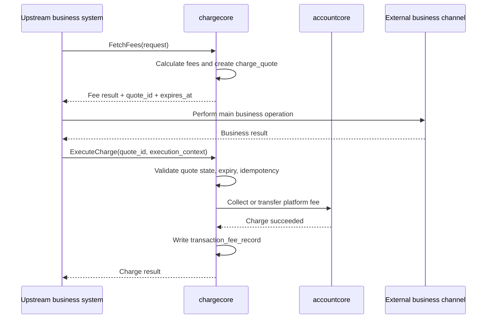

# ChargeCore Fee Execution Plan

## 1. Scope and Current Boundary

This document was a **future-state plan**, outside the then-current fee-calculation delivery scope. The established scope at the time was `CalculateFees / FetchFees`, `CommitFeeRecords`, and a unified query for fee results. It did not yet include a fee-execution center.

The proposed later capability would execute a charge against a locked fee snapshot, use `accountcore` for the platform-fee movement, and write unified fee-detail records after successful collection. All schemas and APIs below are design proposals, not a claim of implementation.

## 2. Design Decisions

### Lock a Quote Before Executing a Charge

The proposed sequence was `FetchFees` returning both the fee result and a `charge_quote`; the upstream system performing the main business operation; and `ExecuteCharge` consuming that quote. Recalculating the fee from the newest rules during execution, or refusing the charge solely because rules changed, would create an inconsistency after a merchant had seen a fee and the upstream business had already run. The execution step should therefore consume the confirmed snapshot. An expired quote, however, should be rejected and fetched again.

### Keep Business Fulfillment Upstream

`chargecore` would own platform charges to merchants, fee transfers, and fee-detail recording. Upstream systems would retain their business state machines; OSL, bank, `chaincore`, and custody integrations; business holds, releases, withdrawals, payments, and settlement; and compensation when the business operation fails. Fee collection is a separate responsibility from fulfilling a payout or withdrawal.

### Use `accountcore` for Money Movement

The main new integration for fee execution would be `accountcore`. Holds, debits, unfreezes, credits, and fee transfers are account and ledger operations, not business-fulfillment operations. `chargecore` would orchestrate the platform-fee action through that system.

## 3. Proposed Data Model

A lightweight `charge_quote` table would lock one executable fee snapshot, track its state and expiry, and retain the execution result. The existing `transaction_fee_record` would remain the final fee-detail table.

| Field | Type | Purpose |
| --- | --- | --- |
| `id` | bigint | Physical primary key |
| `quote_id` | varchar(64) | Unique business ID for the fee quote |
| `merchant_id` | varchar(64) | Merchant |
| `source_system` | varchar(32) | Origin, for example `settleplatform`, `fundprod`, or `payout` |
| `source_biz_type` | varchar(32) | Origin business type |
| `source_biz_id` | varchar(64) | Origin business record |
| `charge_timing` | varchar(16) | `t1` or `realtime` |
| `fee_currency` | varchar(16) | Fee currency |
| `total_fee_amount` | bigint | Total fee in minor units |
| `status` | varchar(16) | `active`, `executed`, `expired`, or `canceled` |
| `quote_snapshot` | json | Fee items, rule references, amounts, and necessary business context |
| `expires_at` | datetime(3) | Expiry |
| `executed_at` | datetime(3) | Completion time, nullable |
| `execute_idempotency_key` | varchar(64) | Execution idempotency key, nullable |
| `accountcore_txn_id` | varchar(64) | Ledger transaction ID, nullable |
| `created_at`, `updated_at` | datetime(3) | Audit timestamps |

The snapshot should contain each fee item's category, item, channel, and amount; `fee_source_ref_type/ref_id/ref_version`; calculation base, rate, and fixed charge; any FX quote; and the total fee and net amount shown to the merchant. Keeping these items in JSON avoided a separate `charge_quote_item` table in this initial design. A child table could be considered if large-scale item-level queries later warranted it.

One `charge_quote` could produce multiple `transaction_fee_record` rows. Each final record could trace its `quote_id` through `fee_snapshot`. The distinction is temporal: the quote is the locked **pre-execution** decision; the fee record is the **post-success** result.

## 4. Execution Flow



`ExecuteCharge` uses `quote_snapshot` and does not reprice from current rules. It rejects an expired quote and requires a new fee result.

The same boundary was tested against four proposed integrations:

| Scenario | Upstream's responsibility | Fee-execution call |
| --- | --- | --- |
| T+1 settlement, `settleplatform` | Continue settlement orchestration after `FetchFees(summary_id, items[])` | `ExecuteCharge(quote_id, settlement_result)` asks `accountcore` for a fee transfer and records the result; quote lifetime can be short within one settlement job |
| Realtime fiat off-ramp, `fundprod` | Request a quote, then execute withdrawal through OSL or a bank | `ExecuteCharge(quote_id, actual_result)` collects/transfers the platform fee; `chargecore` does not call OSL |
| Realtime crypto withdrawal, `fundprod` | Execute withdrawal through `chaincore` or custody | Execute the fee after the withdrawal result, through `accountcore` |
| Realtime batch payout, `payout` | Maintain batch and item state machines, and perform payment through its channel | Execute the fee against the settled batch result; `chargecore` does not take over payout fulfillment |

In each case, fee execution follows the main business operation's result. The plan did not transfer settlement, withdrawal, chain, or batch-payout orchestration into `chargecore`.

## 5. Proposed APIs

### `FetchFees`

Calculate fees, create an executable snapshot, and return a merchant-visible estimate and a quote for later execution. The request would identify source system, merchant, charge timing, currency, and business items with product, amount, currency, and contextual information such as FX quote and channel. The response would contain `quote_id`, `expires_at`, currency, total, and per-business-item fee details, including category and amount.

```json
{
  "source_system": "fundprod",
  "merchant_id": "800000000001",
  "charge_timing": "realtime",
  "currency": "USDT",
  "items": [{
    "source_biz_type": "fiat_offramp_payout",
    "source_biz_id": "wr_xxx",
    "product_code": "off_ramp",
    "amount": "1000.00",
    "currency": "USDT",
    "context": { "quote_id": "fxq_xxx", "channel": "OSL" }
  }]
}
```

```json
{
  "quote_id": "cq_xxx",
  "expires_at": "2026-05-23T12:05:00+08:00",
  "currency": "USDT",
  "total_fee_amount": "35.10",
  "items": [{
    "source_biz_id": "wr_xxx",
    "total_fee_amount": "35.10",
    "fee_items": [
      { "fee_category": "channel_service_fee", "fee_item": "risk_control_fee", "fee_amount": "0.10" },
      { "fee_category": "channel_service_fee", "fee_item": "osl_bank_fee", "fee_amount": "35.00" }
    ]
  }]
}
```

### `ExecuteCharge`

Consume the locked quote, perform the platform-fee funds action, and write unified final details. The request would include `quote_id`, `execute_idempotency_key`, and an execution context binding the call to the originating business record and actual outcome. The response would report status, `accountcore_txn_id`, final fee-record IDs, and execution time.

```json
{
  "quote_id": "cq_xxx",
  "execute_idempotency_key": "exec_wr_xxx_v1",
  "execution_context": {
    "source_system": "fundprod",
    "source_biz_type": "fiat_offramp_payout",
    "source_biz_id": "wr_xxx",
    "business_status": "completed",
    "actual_amount": "1000.00",
    "actual_currency": "USDT"
  }
}
```

```json
{
  "quote_id": "cq_xxx",
  "charge_status": "succeeded",
  "accountcore_txn_id": "at_xxx",
  "record_ids": ["tfr_off_001", "tfr_off_002"],
  "executed_at": "2026-05-23T12:03:00+08:00"
}
```

### `GetChargeQuote`

For operations investigation and upstream compensation, the query would expose `quote_id`, status, expiry, execution time, total fee, and `quote_snapshot`.

## 6. Execution Guards and Deferred Cases

`ExecuteCharge` should check that the quote exists, is `active`, has not expired, has not already been executed under the idempotency key, and belongs to the given execution context. It should **not** replace a previously shown fee with a calculation from newer rules or reject an already performed main business operation solely because the pricing rule changed.

The plan recommended deferring on-ramp FX-spread product fees and cases that depend deeply on asynchronous channel outcomes whose final fee is only known when fulfillment finishes.

The intended evolution was from a fee-calculation and result center toward execution **against locked snapshots**, while upstream systems retained fulfillment and `accountcore` remained the money-movement system. That was a design direction, not a released capability.
