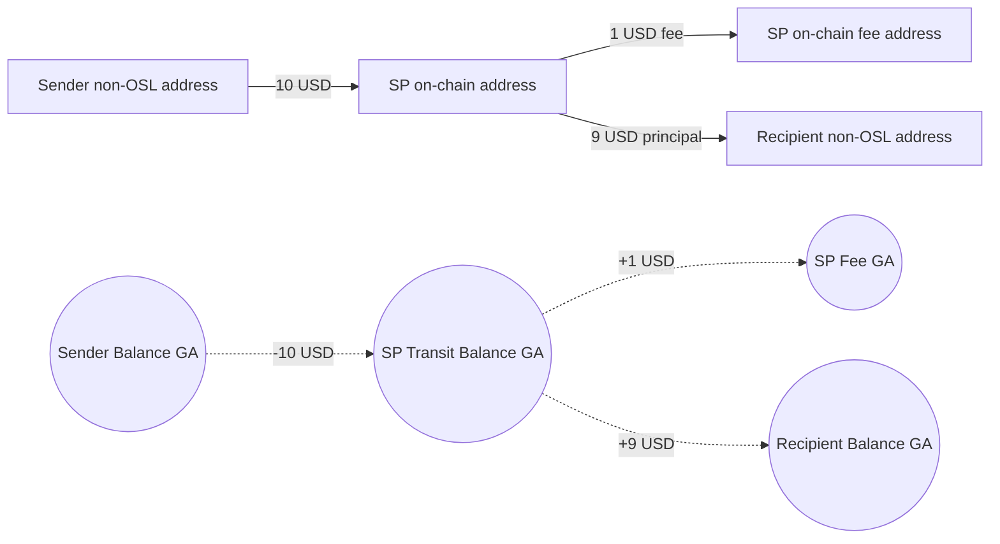
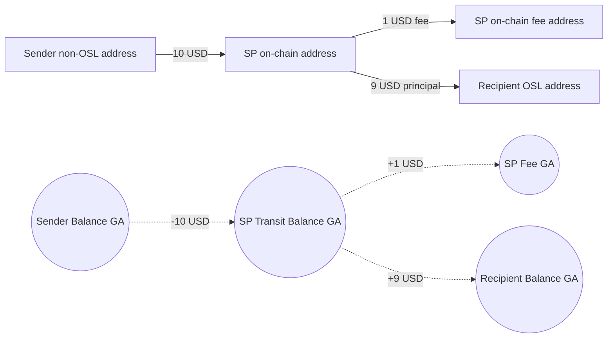
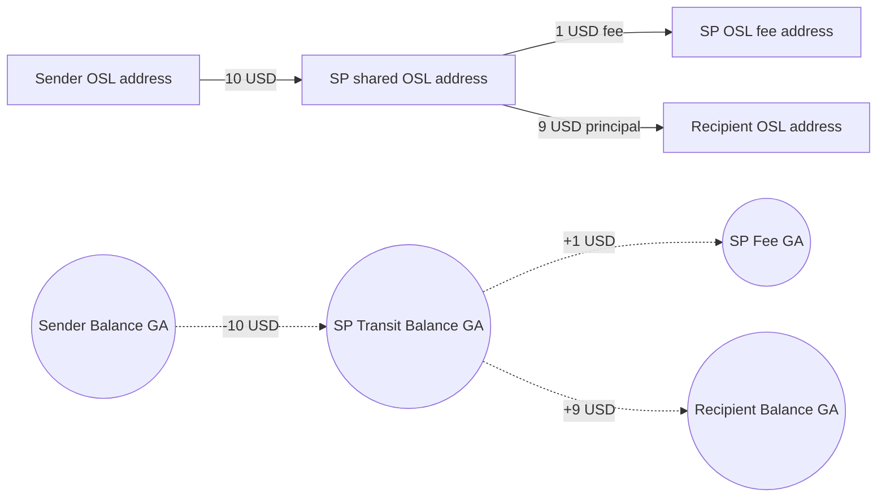
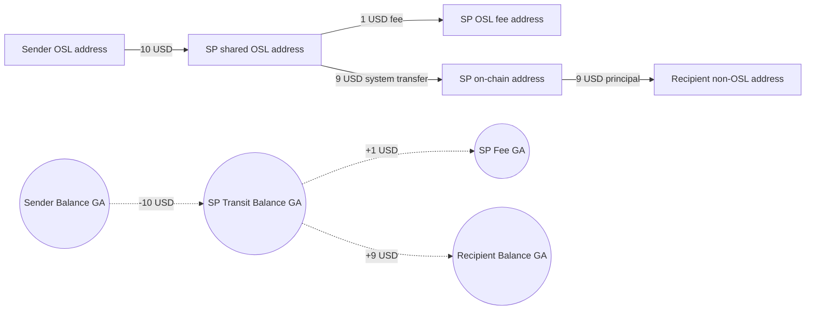
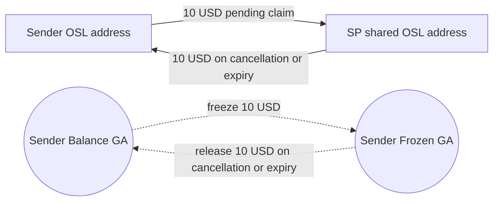
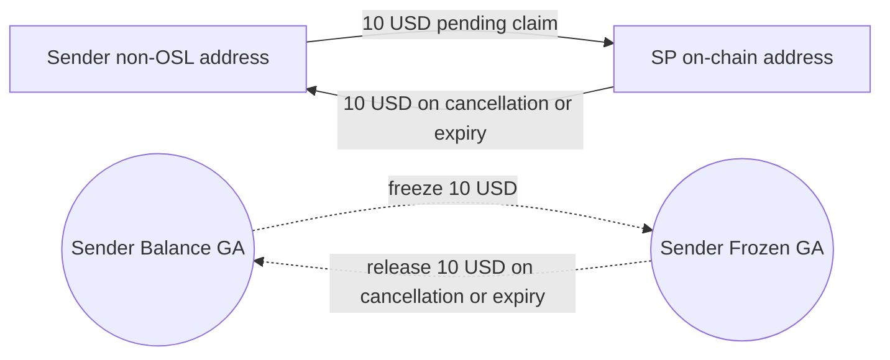

# Payout to a StablePay Account: Funds and Account Flows

## Reading Conventions

Every scenario uses **10 USD**. The StablePay Account experience is shown as **Free** to the merchant. The diagrams and tables use the platform's internal view: when a fee applies to a registered-recipient scenario, 1 USD goes to the relevant StablePay OSL or on-chain fee address, and 9 USD goes to the recipient. Both address movement and general-account (GA) movement pass through StablePay transit; the model does not treat same-system movement as direct. For an unregistered recipient, this document shows only where funds wait and how they return on cancellation or expiry. A successful claim then follows the relevant registered-recipient scenario.

The address columns below represent physical funds accounts. The GA columns are virtual funds accounts in AccountCore. `SP` means StablePay.

## 5.1 non-OSL Sender to Registered non-OSL Recipient

The sender's non-OSL address pays 10 USD to the SP on-chain address. SP splits 1 USD to its on-chain fee address and pays the remaining 9 USD to the recipient's non-OSL address. In parallel, Sender Balance GA decreases by 10, SP Transit Balance GA first gains 10 and then pays out 1 plus 9, SP Fee GA gains 1, and Recipient Balance GA gains 9.

| Stage | Sender address | SP address | Recipient address | SP fee address | Sender GA | Transit GA | Recipient GA | Fee GA |
|---|---:|---:|---:|---:|---:|---:|---:|---:|
| Payment | -10 | +10 | 0 | 0 | -10 | +10 | 0 | 0 |
| Fee split | 0 | -1 | 0 | +1 | 0 | -1 | 0 | +1 |
| Principal | 0 | -9 | +9 | 0 | 0 | -9 | +9 | 0 |

## 5.2 non-OSL Sender to Registered OSL Recipient

The sender's non-OSL address sends 10 USD to the SP on-chain address. SP sends 1 USD to the on-chain fee address and 9 USD to the recipient's OSL address. The virtual GA entries follow the same 10-to-1-plus-9 split as section 5.1.

| Stage | Sender non-OSL address | SP on-chain address | Recipient OSL address | SP on-chain fee address | Sender GA | Transit GA | Recipient GA | Fee GA |
|---|---:|---:|---:|---:|---:|---:|---:|---:|
| Payment | -10 | +10 | 0 | 0 | -10 | +10 | 0 | 0 |
| Fee split | 0 | -1 | 0 | +1 | 0 | -1 | 0 | +1 |
| Principal | 0 | -9 | +9 | 0 | 0 | -9 | +9 | 0 |

## 5.3 OSL Sender to Registered OSL Recipient

The OSL sender pays 10 USD to the shared SP OSL address. That address sends 1 USD to the SP OSL fee address and 9 USD to the recipient OSL address. The same virtual GA movements represent the balance deduction, fee split, and principal credit.

| Stage | Sender OSL address | Shared SP OSL address | Recipient OSL address | SP OSL fee address | Sender GA | Transit GA | Recipient GA | Fee GA |
|---|---:|---:|---:|---:|---:|---:|---:|---:|
| Payment | -10 | +10 | 0 | 0 | -10 | +10 | 0 | 0 |
| Fee split | 0 | -1 | 0 | +1 | 0 | -1 | 0 | +1 |
| Principal | 0 | -9 | +9 | 0 | 0 | -9 | +9 | 0 |

## 5.4 OSL Sender to Registered non-OSL Recipient

The OSL sender pays 10 USD to the shared SP OSL address. SP sends 1 USD to its OSL fee address. The remaining 9 USD crosses from the shared OSL address to the SP on-chain address, then reaches the recipient's non-OSL address. This cross-system transfer does not change the virtual GA balances; the GA fee and principal movements occur at the split and final credit.

| Stage | Sender OSL | Shared SP OSL | SP on-chain | Recipient non-OSL | SP OSL fee | Sender GA | Transit GA | Recipient GA | Fee GA |
|---|---:|---:|---:|---:|---:|---:|---:|---:|---:|
| Payment | -10 | +10 | 0 | 0 | 0 | -10 | +10 | 0 | 0 |
| Fee split | 0 | -1 | 0 | 0 | +1 | 0 | -1 | 0 | +1 |
| OSL to on-chain | 0 | -9 | +9 | 0 | 0 | 0 | 0 | 0 | 0 |
| Principal | 0 | 0 | -9 | +9 | 0 | 0 | -9 | +9 | 0 |

## 5.5 OSL Sender to Unregistered Recipient

The 10 USD waits at the **shared SP OSL address** until the recipient claims it. The sender's Balance GA decreases by 10 and Frozen GA increases by 10. If the transfer is cancelled or expires, the address sends 10 USD back by the original route and the virtual frozen amount is released. There is **no fee split while the claim is pending**.

After a successful claim, an OSL recipient follows section 5.3 and a non-OSL recipient follows section 5.4, including the applicable fee split.

| Stage | Sender OSL address | Shared SP OSL address | Sender Balance GA | Sender Frozen GA |
|---|---:|---:|---:|---:|
| Create pending payout | -10 | +10 | -10 | +10 |
| Cancel or expire | +10 | -10 | +10 | -10 |

## 5.6 non-OSL Sender to Unregistered Recipient

The 10 USD waits at the **SP on-chain address**. The sender's Balance GA decreases by 10 and Frozen GA increases by 10. Cancellation or expiry returns 10 USD to the sender's non-OSL address and releases the frozen virtual balance. No fee is split in the pending state.

After a successful claim, an OSL recipient follows section 5.2 and a non-OSL recipient follows section 5.1, including the applicable fee split.

| Stage | Sender non-OSL address | SP on-chain address | Sender Balance GA | Sender Frozen GA |
|---|---:|---:|---:|---:|
| Create pending payout | -10 | +10 | -10 | +10 |
| Cancel or expire | +10 | -10 | +10 | -10 |
