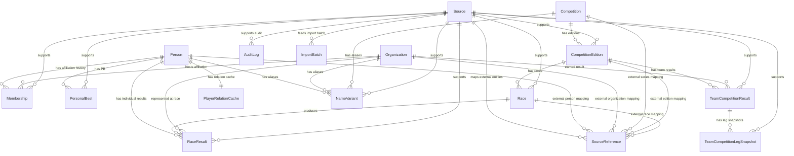

# Data Model and Entity Map

**Source document updated:** July 1, 2026 (CST). This explains the Prisma schema and migrations as they stood when the source was written. It is a model reference for that point in time, not a guarantee that today's schema is identical.

## What the Model Covers

1. **People and organizations:** `Person` covers athletes, coaches, and staff. `Organization` covers schools, universities, corporate running teams, companies, clubs, and similar bodies.
2. **Affiliation history:** `Membership` says when a person belonged to an organization.
3. **Competitions and results:** `Competition`, `CompetitionEdition`, and `Race` form the event hierarchy. `RaceResult` and `PersonalBest` hold individual performance; `TeamCompetitionResult` and `TeamCompetitionLegSnapshot` hold team performance.
4. **Provenance and governance:** `Source`, `SourceReference`, `AuditLog`, and `ImportBatch` explain where facts came from, how they were imported, and how records changed.
5. **Derived content:** `PlayerRelationCache` stores computed athlete relationships for page reads.

## Entity Relationships

## Tables and Fields

### 1. `Person`

One stable record per athlete, coach, or staff member. `id` is the key; `slug` is the stable URL identifier. `displayNameJa`, `displayNameKana`, `displayNameRoman`, `displayNameZh`, and `displayNameEn` store display forms and reading. `birthDate`, `hometown`, `nationality`, `heightCm`, and `weightKg` are biographical fields. `type` classifies the person, `status` tracks data verification, `notes` adds context, and `createdAt`/`updatedAt` are timestamps. The earlier `registeredPrefecture` field had been removed.

### 2. `Organization`

One entity type represents schools, universities, corporate teams, companies, and clubs. `id` and `slug` identify it. `nameJa`, `nameKana`, `nameRoman`, `nameZh`, `nameEn`, and `shortName` are name forms; `type` is the organization category. `location`, `prefecture`, `country` (default `JP`), and `websiteUrl` describe place and official site. `status` and `notes` record verification and context.

### 3. `Membership`

Records a person's affiliation with an organization over time, for example university enrollment or later membership of a corporate team. `personId` and `organizationId` link the two; `type` describes the relationship. `startDate`, `endDate`, `startYear`, and `endYear` describe and help query the interval. `faculty`, `department`, and `cohort` add educational context. `role` is a fixed enum for the person's role, while `status` and `sourceId` track verification and provenance. The older `grade` field had been removed.

### 4. `PersonalBest`

A snapshot of a person's **current best** mark in a discipline, rather than every historical attempt. `personId` and `discipline` identify the athlete and event; `mark` keeps the original text such as `28:12.34`, while `markMillis` supports sorting and comparisons. `achievedOn`, `competitionName`, and `venue` describe when and where it happened. `organizationId` snapshots affiliation at that time; `stage`, `isHighSchoolPb`, and `isCollegePb` describe career context. `status` and `sourceId` hold verification and source. In this Prisma version, `PersonalBest.organizationId` was a field, not a declared foreign-key relation.

### 5. `Competition`

The event series or brand, such as Hakone Ekiden, Izumo Ekiden, the national high-school ekiden, or Osaka Marathon. `slug` identifies the series; `nameJa` and `nameZh` are names; `type` is the series category; `organizer`, `region`, and `websiteUrl` give context.

### 6. `CompetitionEdition`

One occurrence of a series, such as the 102nd Hakone Ekiden. `competitionId` links the series, `slug` is its stable identifier, and `editionNumber`, `year`, `officialName`, `shortName`, `startsOn`, and `endsOn` define the edition. `sourceId` records provenance.

### 7. `Race`

A finer unit within an edition: an ekiden leg, track heat, or other race group. `competitionEditionId` links the edition; `slug` and `name` identify the unit. `discipline`, `leg`, `round`, `heat`, `distanceMeters`, and `startsAt` describe it. `status` and `sourceId` track verification and provenance.

### 8. `RaceResult`

One person's result within one `Race`. `personId` and `raceId` link athlete and unit; `organizationId` is the team represented **at that race**, which need not imply long-term membership. `isEntry`, `isStarter`, and `isRaceDayChange` distinguish registration, actual appearance, and a race-day change. `mark` and `markMillis` hold the performance; `rank` and `teamRank` hold placing. `gradeAtRace` is a time-specific grade snapshot. `status`, `notes` (such as a leg win or record), and `sourceId` complete the record.

### 9. `TeamCompetitionResult`

One organization's final team result for an edition. `competitionEditionId` and `organizationId` form the logical identity; `finalRank`, `finalMark`, and `finalMarkMillis` hold placing and cumulative performance. `status` and `sourceId` track verification and provenance. The same edition and organization should have only one such record.

### 10. `TeamCompetitionLegSnapshot`

The team's cumulative position after a given leg. `teamCompetitionResultId` identifies the final team record; `leg`, `cumulativeRank`, `cumulativeMark`, and `cumulativeMarkMillis` describe position and time. `gapFromLeader` and `gapFromLeaderMillis` describe the deficit. `status` and `sourceId` track verification and source.

### 11. `PlayerRelationCache`

Stores computed relationships, **not original facts**. `personId` identifies the athlete, `payload` is the result JSON, `generatedAt` is the calculation time, and `sourceHash` helps detect staleness. A person has at most one relation cache record.

### 12. `Source`

The provenance record. `name`, `url`, and `type` identify the source; `publishedOn` and `accessedOn` distinguish publication from access. `reliability` defaults to 3, and `notes` hold qualification.

### 13. `NameVariant`

Captures another name for the same person, organization, or competition, such as an official Japanese form, media spelling, Chinese translation, or school abbreviation. `value`, `language`, `type`, and `isPrimary` define the variant. Exactly the applicable target relation uses `personId`, `organizationId`, or `competitionId`; `sourceId` records where the name came from.

### 14. `AuditLog`

Records data maintenance, **not a real-world race event**. `entityType`/`entityId` identify the changed record; `action`, `fieldName`, `oldValue`, and `newValue` describe the change; `reasonType` and `reasonNote` explain it. `sourceId` supports the decision, `actorType`/`actorId` identify who or what made it, `batchId` groups changes, `metadata` holds additional JSON, and `createdAt` dates the audit entry.

### 15. `SourceReference`

Maps an entity from an external source to a stable internal record, such as an athlete on a university site or a race in a PDF. `sourceId`, `sourceEntityType`, `sourceEntityKey`, and `sourceUrl` identify the external object. The applicable `personId`, `organizationId`, `competitionId`, `competitionEditionId`, or `raceId` links the internal one; `metadata` holds extra JSON. The combination `sourceId + sourceEntityType + sourceEntityKey` should map only once.

### 16. `ImportBatch`

Tracks one formal import run. `key` uniquely identifies it; `type` and `status` classify it; `sourceId` names the source. `summary`, `payload`, `startedAt`, `completedAt`, and `errorMessage` retain the input, timing, result, and failure detail.

## Enum Dictionary

| Enum | Value | Meaning |
| --- | --- | --- |
| `DataStatus` | `verified` | Checked and confirmed |
| | `pending` | Awaiting confirmation |
| | `conflicting` | Sources disagree |
| | `missing` | Required data is absent |
| `PersonType` | `athlete` | Athlete |
| | `coach` | Coach |
| | `staff` | Staff or manager |
| `MembershipRole` | `athlete` | Athlete at this organization |
| | `coach` | Coach at this organization |
| | `staff` | Staff at this organization |
| `OrganizationType` | `junior_high_school` | Junior high school |
| | `high_school` | High school |
| | `university` | University |
| | `corporate_team` | Company running team |
| | `company` | Legal company entity |
| | `club` | Club |
| | `federation` | Association or federation |
| | `organizer` | Event-organizing body |
| `MembershipType` | `origin` | School or organization of origin |
| | `enrolled` | Enrolled or attending |
| | `affiliated` | Affiliated or competing for |
| | `graduated` | Graduated from |
| | `staff` | Employed or serving as staff |
| `NameVariantType` | `official` | Official name |
| | `short` | Abbreviation |
| | `kana` | Kana form |
| | `romanized` | Romanized form |
| | `chinese` | Chinese translation |
| | `english` | English name |
| | `former` | Former name |
| | `media` | Common media form |
| `SourceType` | `university_official` | Official university source |
| | `hakone_official` | Official Hakone source |
| | `ntv` | NTV source |
| | `jaaf` | Japan Association of Athletics Federations source |
| | `rikujokyogi_magazine` | Specialist athletics media |
| | `data_site` | Data site |
| | `fan_site` | Fan site |
| | `pdf` | PDF source |
| | `manual` | Manual entry |
| `EventDiscipline` | `m1500` | Men's 1,500 m |
| | `m3000` | Men's 3,000 m |
| | `m3000sc` | Men's 3,000 m steeplechase |
| | `m5000` | Men's 5,000 m |
| | `m10000` | Men's 10,000 m |
| | `ten_mile` | Ten miles |
| | `half_marathon` | Half marathon |
| | `marathon` | Marathon |
| | `ekiden_leg` | Ekiden leg |
| `CompetitionType` | `university_ekiden` | University ekiden |
| | `high_school_ekiden` | High-school ekiden |
| | `corporate_ekiden` | Corporate-team ekiden |
| | `mixed_ekiden` | Mixed or general ekiden |
| | `track_meet` | Track meet |
| | `road_race` | Road race |
| | `marathon` | Marathon |
| `AuditAction` | `create` | Create |
| | `update` | Update |
| | `delete` | Delete |
| | `verify` | Verify |
| | `merge` | Merge entities |
| | `split` | Split entity |
| `AuditReasonType` | `initial_entry` | Initial entry |
| | `source_update` | Change due to new source data |
| | `source_correction` | Corrected using a more reliable source |
| | `stale_source` | Replaced outdated source |
| | `manual_error` | Corrected human error |
| | `format_normalization` | Standardized format |
| | `translation_update` | Updated translation |
| | `verification_update` | Changed verification status |
| | `entity_merge` | Merged entities |
| | `entity_split` | Split entity |
| | `import` | Generated by an import |
| | `system` | Generated by the system |
| `AuditActorType` | `admin` | Administrator or manual operator |
| | `import_script` | Import script |
| | `system` | Automated system |
| `ImportBatchStatus` | `pending` | Not yet run |
| | `running` | Running |
| | `completed` | Completed |
| | `failed` | Failed |

## Changes From the Earlier Draft

`Person.registeredPrefecture` and `Membership.grade` had been removed. `Membership.role` and `Competition.type` had become enums instead of free text. `TeamCompetitionResult`, `TeamCompetitionLegSnapshot`, and `PlayerRelationCache` had been added.

In short: `Person` is the person, `Organization` the school or team, and `Membership` their dated connection. `Competition -> CompetitionEdition -> Race` moves from series to occurrence to race unit. `RaceResult` is an individual's performance; `TeamCompetitionResult` is the team's final result; `Source` says where the fact came from.
