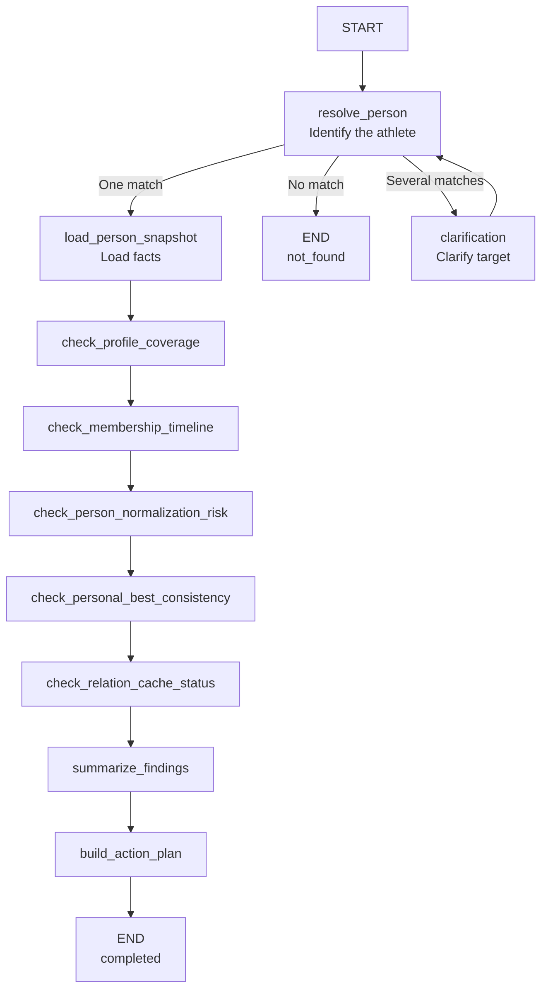

# Tasuki Keifu Agent V1: Technical Plan

This document defines a V1 plan. The stages, tool contracts, and deployment steps below describe intended work, not a claim that each component was delivered.

## 1. Objective and Starting Point

The first agent for `tasuki-keifu` would be an **internal business tool for data maintenance and profile diagnosis**. It would not be a public chat product, open-ended question-answering system, or general agent platform. Its fixed first use case was a `person diagnosis graph`: accept an athlete by slug, ID, or name; inspect the current record; report anomalies and risks; and suggest actions.

The project already had a primary fact database and Prisma model, reusable maintenance and audit scripts, a documented data-audit and source policy, and a relation cache with basic logging. V1 could wrap these existing capabilities in a constrained graph instead of inventing a new business workflow. The target architecture was one business-specific agent, a strongly bounded graph, and an internal tool entry point, with no multi-agent collaboration.

## 2. V1 Scope

The planned deliverables were a LangGraph-based person diagnosis graph in a separate repository; reads from the `tasuki-keifu` primary business database; an independent database for agent runs; minimal observability; and structured findings plus suggested actions.

V1 deliberately excluded automatic database repair, a public conversation interface, complete organization/race/import-batch graphs, a generic MCP tool platform, a full evaluation platform, and multiple agents. The primary business database would be **read-only** to the agent in this phase.

## 3. Technology and Deployment Choices

`LangGraph` was selected for graph state, checkpoints, and interrupt or clarification paths, fitting the intended constrained runtime. TypeScript and an internal CLI or admin entry point matched the main application's stack and made existing query and script logic easier to reuse. The observability plan used LangSmith for graph traces, node paths, tool calls, and error paths; structured logs for runs; and the agent database for runs, checkpoints, and diagnosis results.

The agent would live in its own `tasuki-keifu-agent` repository. `tasuki_keifu` remained the primary fact database, while `tasuki_keifu_agent` held runtime data. V1 would initially deploy on the same machine as the main business application, but as a separate process or container, without requiring a separate server instance.

## 4. Person Diagnosis Graph

The input accepts `personSlug`, `personId`, or `personName`. Output consists of findings, a summary of the person's current data state, and suggested actions. The proposed nodes were:

1. `resolve_person`
2. `load_person_snapshot`
3. `check_profile_coverage`
4. `check_membership_timeline`
5. `check_person_normalization_risk`
6. `check_personal_best_consistency`
7. `check_relation_cache_status`
8. `summarize_findings`
9. `build_action_plan`

Person normalization was a **risk-detection** node, not permission to merge, split, or normalize records automatically.

Resolution has three outcomes. A unique match loads the snapshot. No match ends with `not_found`. Multiple matches enter `clarification`, ask for a more precise target, and retry `resolve_person`. After loading the snapshot, five checks add findings, then the graph summarizes them and builds an action plan. Only resolution can interrupt for clarification in V1; the other checks do not interrupt and none modifies business data.



## 5. Tool Boundary

The proposed read tools were `resolve_person_tool`, `load_person_snapshot_tool`, and `check_relation_cache_tool`. Script-wrapping audit tools were `audit_profile_coverage_tool`, `audit_membership_timeline_tool`, `audit_person_normalization_risk_tool`, and `audit_personal_best_consistency_tool`.

An automatic `person_normalization_tool` was deferred. Merge, normalization, and repair capabilities were spread across several scripts; V1 would detect risk before considering any execution path.

## 6. Minimal Graph State

```ts
type PersonDiagnosisState = {
  input: {
    personSlug?: string;
    personId?: string;
    personName?: string;
    triggeredBy?: "cli" | "admin_api";
  };

  target: {
    personId: string | null;
    personSlug: string | null;
    resolved: boolean;
  };

  snapshot: {
    profile?: unknown;
    memberships?: unknown[];
    personalBests?: unknown[];
    relationCache?: unknown | null;
  };

  findings: DiagnosisIssue[];
  actions: SuggestedAction[];

  runtime: {
    runId: string;
    status: "running" | "need_clarification" | "completed" | "failed";
    currentNode: string;
    startedAt: string;
    errorMessage?: string;
  };
};
```

This state separates input, resolved target, loaded facts, diagnostic output, and execution metadata. The graph can explain its path and persist or resume a run without granting business-data write access.

## 7. Confirmed Design Decisions and Open Details

The document fixed the direction: start with an internal data-maintenance agent; build the business graph before extracting a generic harness; widen coverage before deepening selected checks; begin with person diagnosis, then consider organization diagnosis; treat relation-cache health as one person check; diagnose before executing; keep the primary database read-only; use separate repository and agent database; and include LangSmith in V1.

Two details remained to be confirmed: the exact CLI entry-point shape and how the primary business repository and agent repository would connect.

## 8. V1 Tool Contracts

All tools should use a consistent success/error envelope:

```ts
type ToolResult<T> = {
  ok: boolean;
  data?: T;
  error?: { code: string; message: string };
};
```

`resolve_person_tool` accepts any of `personSlug`, `personId`, or `personName`. Its output distinguishes a unique match, several candidates, and no match:

```ts
{
  matchType: "unique" | "multiple" | "not_found";
  person?: {
    personId: string;
    personSlug: string;
    displayNameJa: string;
  };
  candidates?: Array<{
    personId: string;
    personSlug: string;
    displayNameJa: string;
  }>;
}
```

`load_person_snapshot_tool` takes `personId` and returns profile, memberships, personal bests, and relation cache:

```ts
{
  profile: Record<string, unknown>;
  memberships: Array<Record<string, unknown>>;
  personalBests: Array<Record<string, unknown>>;
  relationCache: Record<string, unknown> | null;
}
```

Audit tools share `{ findings: DiagnosisIssue[] }`. `check_relation_cache_tool` takes `personId` and returns findings plus `cacheStatus: "fresh" | "stale" | "missing" | "invalid"`.

## 9. Diagnosis and Action Contracts

```ts
type DiagnosisIssue = {
  category:
    | "profile_coverage"
    | "membership_timeline"
    | "person_normalization"
    | "personal_best_consistency"
    | "relation_cache";
  severity: "info" | "warning" | "error" | "critical";
  title: string;
  detail: string;
  evidence?: Record<string, unknown>;
  sourceTool:
    | "audit_profile_coverage_tool"
    | "audit_membership_timeline_tool"
    | "audit_person_normalization_risk_tool"
    | "audit_personal_best_consistency_tool"
    | "check_relation_cache_tool";
};

type SuggestedAction = {
  type: "script" | "manual_check" | "recompute" | "defer";
  name: string;
  reason: string;
  command?: string;
  riskLevel: "low" | "medium" | "high";
  relatedIssueCategories?: DiagnosisIssue["category"][];
};
```

The output must name evidence and the tool that produced each issue. Suggested actions carry an explicit risk level and can be a script recommendation, manual check, recomputation, or deferral; the graph does not execute them automatically.

## 10. Agent Runtime Database

V1 separated `tasuki_keifu` (business facts) from `tasuki_keifu_agent` (runtime). The proposed tables were `agent_runs` for one diagnosis run and its LangSmith trace; `agent_checkpoints` for graph-state snapshots; `agent_events` for node, tool, clarification, and error events; and `diagnosis_results` for findings, action plan, and summary.

Each table would have a database `id`; `agent_runs.run_id` would be unique, with other tables joined by `run_id`. The first version would use JSONB for `agent_checkpoints.state_json`, `agent_events.event_payload_json`, `diagnosis_results.findings_json`, and `diagnosis_results.actions_json`. `agent_runs.trace_id` would link to a LangSmith trace; `agent_events.span_id` could optionally link to a span. LangSmith was for trace observability, while the agent database retained operational state and business diagnosis output.

## 11. Delivery Stages

These stages were a plan for implementation and validation:

| Stage | Work |
| --- | --- |
| A: Freeze design | Fix V1 scope, graph, tool layers, state, and observability; confirm separate repository/database and read-only primary DB |
| B: Initialize project | Create GitHub and local `tasuki-keifu-agent` repositories; set up TypeScript, LangGraph, LangSmith, Prisma, DB driver, CLI dependencies, and directories |
| C: Configure data | Create agent database and Prisma schema; implement four runtime tables; configure read-only business connection, writable agent connection, and LangSmith variables |
| D: Minimal runtime | Define state and graph; add `runId`, status, persistent checkpoints, structured logs, traces, and CLI |
| E: First tools | Implement person resolution, snapshot loading, and relation-cache check; run a minimal graph |
| F: Full audits | Add four audit tools and complete the nine-node graph |
| G: Deployment | Configure repository secrets, build and Docker files, separate service on `ubuntu-3`, database connections, and minimal CI/CD |
| H: Real examples | Test three to five real athlete cases, resolution and clarification, usefulness of findings/actions, and completeness of traces, logs, and checkpoints |

Stage H defined validation work; the document did not report its results.

## 12. Later Iterations

Possible later work included an organization diagnosis graph, stronger normalization-risk checks, dry-run actions, low-risk scripts executed after human approval, batch-level diagnosis, and turning frequently used scripts into standardized tools and runtime capabilities. These were outside V1.
