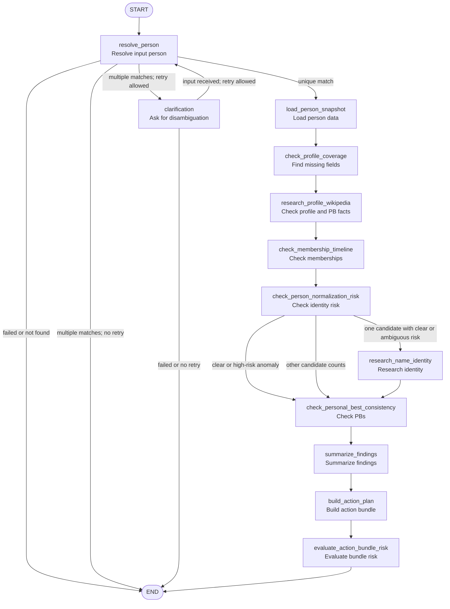
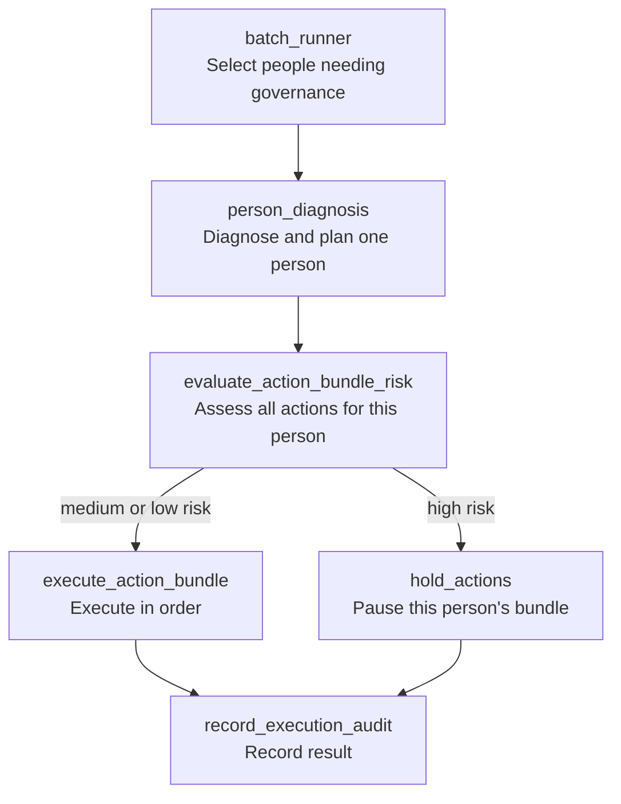
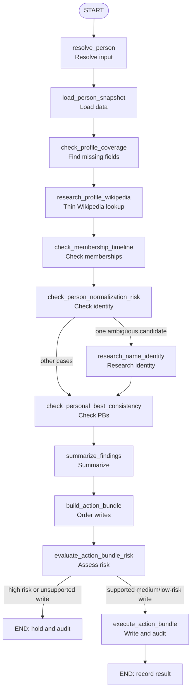

# Tasuki Keifu Agent Graph

This document records the structure of `tasuki-keifu-agent` at the time of writing. It provides a reference for the current nodes and branches, and a place to update diagrams when the graph changes.

## Current Graph

The project had one main graph, `person_diagnosis`. Batch processing was an outer runner, not another graph. A separate batch graph would only make sense if batch orchestration became complex enough to warrant one.

## Current Diagnosis Flow

## Node Responsibilities

- `resolve_person` decides whether the input identifies one person, multiple people, nobody, or an error.
- `clarification` manages one permitted retry after multiple matches.
- `load_person_snapshot` loads the profile, memberships, and personal bests (PBs).
- `check_profile_coverage` records missing fields as low-priority observations; a gap alone does not generate a write.
- `research_profile_wikipedia` calls the MediaWiki API once for a uniquely resolved person to find supported profile and PB fields. It follows standard proxy environment variables and the local macOS system proxy.
- `check_membership_timeline` checks membership chronology.
- `check_person_normalization_risk` applies name-first rules and classifies clear, ambiguous, or high-risk identity cases.
- `research_name_identity` investigates clear or ambiguous identity risk when exactly one candidate exists. The recorded configuration preferred a local Codex provider with `gpt-5.4` and web research, falling back to ordinary LLM judgment if web search was unavailable. `uncertain` adds a finding, `same` retains or strengthens a duplicate finding, and `different` removes a rule-based duplicate finding to avoid merging different people.
- `check_personal_best_consistency` checks PB consistency.
- `summarize_findings` prepares the result summary.
- `build_action_plan` produces proposed actions plus an ordered bundle with payloads and idempotency keys.
- `evaluate_action_bundle_risk` assesses the whole bundle for one person. The source listed confirmed duplicate merges, Wikipedia-backed profile and PB updates, and membership or PB conflict marking as executable actions. Uncertain identity normalization remained held.

## Important Branches

`resolve_person` is the main branch point: a unique match enters diagnosis, no match or an error ends the run, and multiple matches go either to clarification or to the end. Clarification may make one retry through `resolve_person`.

The normalization check is another branch point. Clear cases and high-risk anomalies continue to PB checks, with a finding recorded for the anomaly. Clear or ambiguous risk involving exactly one candidate goes through identity research before PB checks. Other candidate counts continue after recording the relevant finding.

## Planned Batch Boundary

The next stage in the original plan did not turn the one-person graph into a multi-person graph. It added a batch runner around `person_diagnosis`. The runner would select people, schedule and retry work, enforce limits, and record runs. Each person graph would diagnose and generate an action bundle.

High risk should hold only the affected person, not the entire batch. Medium- and low-risk actions follow a predefined order. The diagnosis graph remains the core worker.

## Target Shape of the Person Graph

The plan kept the early checks largely intact and expanded the output side. The front of the graph would still generate findings. `build_action_plan` already produced a structured action bundle; renaming it would require updating the diagram. Bundle-level risk assessment and execution auditing would be added without making the first version too large.

These diagrams distinguish the recorded current graph from a proposed target. Later batch optimization notes document additional write actions after this design snapshot.

## Batch Runner Status Recorded in the Source

The source said an external CLI batch runner had been implemented. It read maximum `Person`, `Membership`, and `PersonalBest` update times from the business database, compared them with each person's latest successful governance time in the agent database, selected eligible people, and invoked `person_diagnosis` one at a time. It saved findings, bundles, risk levels, and action statuses in the agent audit database. Dry-run was the default, with no business-database writes.

At that point in the notes, only a strictly confirmed `merge_person_duplicate` could execute with writes explicitly enabled; other actions were recorded as held. The later batch optimization log records how that execution boundary subsequently changed. This is a historical status note, not a statement about the latest running system.

## Maintenance Rule

Add a section and Mermaid diagram for each new graph. Update the diagrams when nodes, order, or branch conditions change, including any future split of normalization into a subflow. Keep the implemented and target structures visibly distinct.
