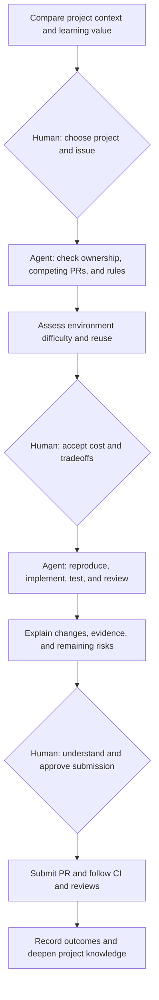

## Why I started

I wanted to use an agent to reduce the time spent searching, setting up environments, and implementing open source contributions while learning useful technology. As the experiment progressed, the central question became where I should participate to build my own understanding and judgment.

As of November 8, 2026, we have submitted PRs to JBang, Keycloak Config CLI, and Checkstyle. A test readability change in Checkstyle was approved by a maintainer, revised in response to CI feedback, and merged. The JBang and Keycloak submissions are still awaiting review. This was our first path from submission to maintainer acceptance, and it clarified the difference between local validation, CI status, and a completed merge.

## Choose a project worth understanding

I used 500 stars as a personal discovery filter across Java developer tools, configuration automation, middleware, and industrial communication. Stars do not establish contribution quality, ease of entry, or maintainer responsiveness.

Before choosing an issue, I want to understand the project, its users, its maintainers, and the relevant module.

| Criterion | What I look for |
|---|---|
| Learning | Technology I want to understand more deeply |
| Collaboration | Recent external contributions and concrete feedback; bot dependency updates alone are insufficient |
| Issue pool | Problems with a clear scope and a meaningful way to validate them |
| Rules | AI policy, contributor agreements, testing, and discussion requirements |
| Environment | Initial setup cost and what can be reused later |

Our early searches concentrated too heavily on AI and agent projects. Searching each interest separately produced a more useful range. Repository topics are maintained by project authors, so topic searches are also incomplete.

## An open issue may already be taken

An issue can remain open and unassigned while someone has claimed it in a comment or submitted a fix. We inspect the issue body, comments, timeline, and PRs in all states. Searches use both the issue number and relevant terms; numeric matches can be unrelated dependency references.

```sh
gh issue view ISSUE_NUMBER --repo OWNER/REPO --json state,assignees,comments,body
gh api repos/OWNER/REPO/issues/ISSUE_NUMBER/timeline
gh search prs ISSUE_NUMBER --repo OWNER/REPO --json number,title,state,url
```

Repeat this check before implementation and submission. Also verify the need itself: an existing option may solve the reported problem, or a proposed fix may change intentional behavior. Clarify that before expanding the scope.

## Separate setup difficulty from reuse

Setup difficulty describes the cost of validating this contribution. Reuse describes how much of that investment helps with future work. A JDK and Maven can serve many Java projects; device networking, service versions, and test data are more specific. Shared tools do not eliminate new dependency downloads.

Distinguish a minimal reproduction, focused regression tests, and full acceptance testing. Running a published CLI and rendering one page can validate a documentation example without proving that the source or entire website builds. Focused tests can establish a code change's key behavior while leaving integration and version-matrix checks outstanding.

We downloaded JDK 21 before discovering that the JBang example worked with the existing Java 8 installation. That JDK was reused for the next contribution, but it was not a requirement of the documentation task.

## Human and agent responsibilities



My role is to choose a direction, understand the real problem, discuss important tradeoffs, and approve contributing under my account. The agent performs technical investigation and validation and explains the evidence and its limits. This does not require me to review every unfamiliar line of code.

Selecting an issue and authorizing publication are separate decisions. We once interpreted a request to continue too broadly, so we made the presentation of concrete results before submission explicit. Existing authorization remains valid; a low-risk assessment alone does not authorize publication.

## Present useful validation evidence

A PR should connect the issue, explain the change, identify key test commands and results, and disclose what was not tested. Keep full logs locally and include enough evidence in the description for a reviewer to assess the work. Screenshots help when there is a visible change to inspect.

Local tests, upstream CI, automated review, and maintainer acceptance are different signals. A successful bot check does not establish complete test coverage, and an open PR is not a merged contribution. Verify review suggestions before applying them.

## From submission to a first merge

[Checkstyle #21417](https://github.com/checkstyle/checkstyle/issues/21417) was a test readability task: replace concatenated XML strings with Java text blocks while preserving the exact output. We started with one test class, then expanded to a related second class. Byte comparisons under both LF and CRLF verified that XML headers, escaping, indentation, and trailing newlines remained unchanged.

The first full build passed locally, but upstream CI identified two issues we had not covered: a fixture referenced a test issue that had since closed, and static analysis recommended `+` concatenation instead. We rebased on the current main branch, made the corrections, and ran the full validation again. All 7,275 unit tests (2 skipped) and 1,416 integration tests passed; a maintainer approved the PR, which was merged on November 8.

This filled a gap in our earlier workflow: passing local tests is not the end of delivery, and maintainer approval does not mean CI has passed. Upstream feedback must become a reproducible change, while checks that ran must remain distinct from checks awaiting maintainer approval. One completed merge provides evidence about this contribution, not a promise that other repositories will follow the same cadence.

## Keep the workbench local

Candidate lists, expired opportunities, PR status tables, environment paths, full logs, and execution notes belong in the local workbench. Blog posts should explain reusable methods, relevant evidence, and technical problems we understand. Discard obsolete candidate dossiers, but preserve the record of submitted contributions and their outcomes.

After submitting a new PR, we check earlier unfinished PRs and update their reviews, checks, and next steps. This follow-up happens alongside active work.

The next stage is sustained work in a small number of repositories. Checkstyle now provides one complete contribution cycle; JBang and Keycloak remain open, and their records should follow actual review and CI status rather than treating submission as completion.

For a concrete example, see [A First JBang PR: Local Tests, Automated Review, and CI Approval](./2026-11-03-JBang开源PR热身记录.md).
