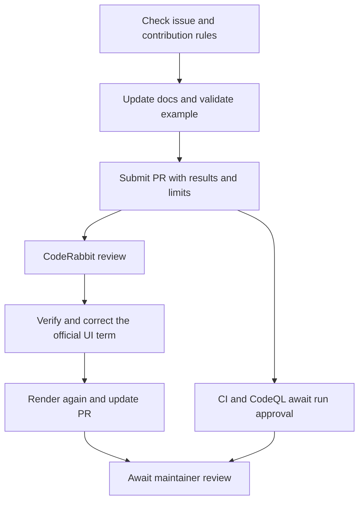

## The problem

[JBang](https://github.com/jbangdev/jbang) runs Java source files and JARs while helping manage dependencies and runtimes. [Issue #2639](https://github.com/jbangdev/jbang/issues/2639) proposed documenting a useful option: set `visualvm.display.name` at launch so the application is easier to identify in VisualVM.

We chose it as a workflow exercise. Its scope was small and it required no server deployment, allowing us to concentrate on investigation, command validation, documentation, and submission.

As of November 3, 2026, [PR #2697](https://github.com/jbangdev/jbang/pull/2697) remains open and has not been merged. This article records the submission stage.

## Check the opportunity and find a suitable location

We checked the issue, comments, assignees, timeline, and competing PRs and found no active claimant or same-topic PR. We then read the contribution and agent guidance and the existing documentation.

The Running page already discussed Flight Recorder, making a nearby VisualVM section a reasonable proposal. The patch added 13 lines covering the launch option, where to find the process, and its use with JAR files. The maintainer still needs to accept the placement.

```sh
jbang run -Dvisualvm.display.name=My-Java-App myapp.java
```

While the application runs, the intended navigation is the Local node in VisualVM's Applications window.

## Validate each claim separately

No production code changed, but the documented command still needed testing.

| Layer | What we did | Evidence provided |
|---|---|---|
| Source execution | Ran a probe with JBang 0.143.0 on macOS x86_64 and Java 8u261, asserting the system property | The launched application receives the requested name |
| JAR execution | Exported the probe as a JAR and ran it with the same option | The statement about JAR files holds |
| Control and inspection | Checked that the property is absent without the option; inspected a running probe with `jcmd` | The property comes from the launch configuration and reaches the target JVM |
| Documentation | Rendered the page with Asciidoctor.js 4.1.1, checked the new link, and ran `git diff --check` | The page renders, the link is accessible, and the patch has no whitespace errors |

The probe's central assertion was simple:

```java
String name = System.getProperty("visualvm.display.name");
if (!"My-Java-App".equals(name)) {
    throw new AssertionError("Unexpected display name: " + name);
}
```

We did not observe the VisualVM GUI, build the full Antora website, or run the full Java test suite. VisualVM's official source supplied additional evidence that it supports the property, but this does not establish a completed GUI test. The PR description disclosed those limits.

The published JBang distribution ran with the existing Java 8 installation. Building the repository has separate JDK requirements. We did not build the whole project for this documentation change.

## An automated review found a terminology error



CodeRabbit noted that the original text called Applications a tab, while VisualVM calls it a window. We checked the [official documentation](https://visualvm.github.io/docs/applications_window.html), corrected the wording, rendered the page again, and updated the PR. The latest automated review passed.

Testing parameter delivery did not cover every wording choice. Automated review added a useful perspective, and its factual claim still needed verification.

## Why the CI appeared to stop

The upstream `ci-build` and `codeql-analysis` runs reported `action_required` without starting individual jobs. This commonly indicates that a maintainer must approve workflows from an external contribution. It is different from a compilation or test failure, and it is not a successful test result either.

The contributor should recognize the state and wait for an authorized maintainer. Updating the documentation does not remove that approval requirement, and an automated review cannot replace it.

GitHub also reported that the branch was behind main but could merge cleanly. Whether an update is required depends on repository policy and maintainer expectations. We chose not to repeatedly update the branch just to remove the notice.

## Where I participated

The agent investigated, prepared the patch, validated commands and rendering, and addressed the review suggestion. I selected the task, understood the change and its limitations, and approved submission under my account.

This small change exercised submission mechanics. The next step is deeper familiarity with project modules and design tradeoffs. Maintainer feedback and acceptance remain part of the learning process still ahead.

For the broader approach, see [AI-Assisted Open Source Contributions: A Workflow from Selection to Submission](./2026-11-03-AI辅助开源贡献协作流程.md).
