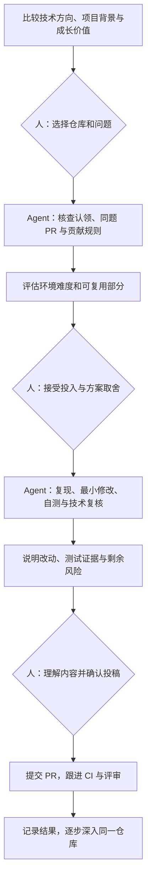

## 为什么开始这次实践

我希望借助 Agent 参与开源项目，降低搜索、环境准备和实现的时间成本，同时接触值得学习的技术。最初的设想是让 AI 多承担执行，自己投入有限的人工时间。实践之后，我更关心的是：人应该在哪些位置参与，才能逐渐形成对项目的理解和判断力。

截至 2026 年 11 月 8 日，我们已提交 JBang、Keycloak Config CLI 和 Checkstyle 的 PR。Checkstyle 的一项测试可读性改进已经获得维护者批准、经过 CI 反馈修正并合并；JBang 与 Keycloak 的投稿仍在等待评审。这让流程第一次从“成功提交”走到了“维护者接受”，也暴露了本地验证、CI 状态和合并结果之间的差别。

## 先选值得理解的项目

我把 500 Star 作为初筛门槛，搜索范围覆盖 Java 开发工具、配置自动化、中间件和工业通信。这个门槛只是个人筛选条件，不能证明项目容易贡献，也不能代替维护活动、贡献规则和任务质量的判断。

比较仓库时，我会先看项目解决什么问题、应用场景、维护组织和相关模块，再看下面几项：

| 判断项 | 需要回答的问题 |
|---|---|
| 成长价值 | 做完后能更理解哪些技术，是否与自己的兴趣有关？ |
| 维护与协作 | 最近有没有接受外部贡献，反馈是否具体？机器人依赖更新不能代表这一点 |
| 问题池 | 有没有范围明确、能够验证的问题？开放数量不是可领取数量 |
| 贡献规则 | 是否接受 AI 辅助，是否有 CLA、测试或沟通要求？ |
| 环境投入 | 首次搭建需要什么，后续换题能复用多少？ |

前期搜索曾过度集中在 AI 和 Agent 项目。后来改为按方向分别查找，才得到更符合个人兴趣的候选。GitHub topic 由维护者填写，因此搜索结果也不是完整的项目地图。

## 一道开放 issue 未必还有贡献空间

有些 issue 无指派、仍开放，但评论中已经有人认领，或关联了尚未合并的修复 PR。仅按状态和标签挑题，会在投入之后才发现重复劳动。

我们使用 GitHub CLI 查询 issue 正文、评论和时间线，再搜索所有状态的 PR。题号搜索之外还要查关键词，并核对结果：纯数字可能匹配到无关的依赖更新。开始实现前和投稿前都要复查一次。

```sh
gh issue view ISSUE_NUMBER --repo OWNER/REPO --json state,assignees,comments,body
gh api repos/OWNER/REPO/issues/ISSUE_NUMBER/timeline
gh search prs ISSUE_NUMBER --repo OWNER/REPO --json number,title,state,url
```

需求也需要验证。报告者遇到的问题可能已有配置可以解决，或者修复会改变原有语义；这时应先澄清范围，不能为了提交 PR 而扩大改动。

## 环境难度和环境通用性分开看

环境难度决定这一题要付出多少准备成本；环境通用性决定这次投入以后还能服务哪些工作。两者应分别记录。

例如，JDK 和 Maven 可以服务多个 Java 项目，而设备网络、特定版本的服务镜像和测试数据通常更专用。即使基础工具相同，不同仓库也仍可能需要重新下载依赖。

还要区分最小复现、定向回归和完整验收。文档题可能只需运行发行版并渲染页面；这并不意味着已构建源码或完整网站。代码题可以先用无容器单测证明关键行为，再说明尚未覆盖的服务集成和版本矩阵。

这次实践也发生过不必要的提前投入：先下载了 JDK 21，后来发现 JBang 文档示例使用本机 Java 8 就能验证。JDK 21 在下一题得到了复用，但它不应被写成前一道题的必要环境。

## 人和 Agent 如何分工



我的参与重点是选方向、理解真实问题、讨论关键取舍，以及确认愿意以自己的账号投稿。Agent 负责技术核查与验证，并把证据和限制解释清楚。提交前可以采用简短说明，不要求我逐行检查陌生代码。

这里仍有一个必要的边界：选择题目与允许公开投稿要分别确认。我们曾把“继续做下一题”理解得过宽，因此把提交前的具体结果展示重新明确下来。已有明确授权时无需反复询问，但不能用“低风险”代替投稿决定。

## 自测证据如何进入 PR

PR 正文应让维护者迅速理解问题、改动和验证范围。通常需要关联 issue、说明为什么修改、列出关键测试命令与结果，并明确未验证项。完整日志保存在本地，正文摘录足够判断的证据；截图用于帮助理解可见变化。

本地测试、上游 CI、机器人评审和维护者认可分别记录。机器人通过不能证明测试覆盖充分，PR Open 也不能记作合并成果。收到建议后，先核对事实，再决定修改。

## 从提交到第一次合并

[Checkstyle #21417](https://github.com/checkstyle/checkstyle/issues/21417) 是一个测试代码可读性任务：把测试中的 XML 字符串拼接改为 Java 文本块，同时保持输出完全一致。我们先在一个测试类做小批次，再扩展到第二个相关类；通过 LF 和 CRLF 两种换行下的字节比较，确认 XML 头、转义、缩进和结尾换行没有变化。

第一次完整构建通过后，远端 CI 指出两类本地未覆盖的问题：基线更新后夹具引用已失效，以及静态检查建议改用 `+` 拼接。我们基于最新主分支修正并重跑完整验证。最终 7,275 项单元测试（2 项跳过）和 1,416 项集成测试均无失败，维护者批准后 PR 于 11 月 8 日合并。

这次经历补全了之前缺失的一段：本地测试通过不是交付终点，维护者批准也不等于 CI 通过。需要把上游反馈转成可复现的修改，再区分哪些检查已运行、哪些仍等待维护者批准。一次完整合并提供了流程证据，但不能推导出其他仓库也会采用相同节奏。

## 把工作台和公开文章分开

本地保留候选清单、过期题、PR 状态、环境路径、完整日志和执行记录。公开文章沉淀可复用的方法、必要的验证证据，以及已经理解的技术问题。尚未投稿的失效候选可以删除独立档案；已经投稿的案例保留结果和复盘。

提交新 PR 后，我们顺手复查之前尚未结束的 PR，更新评审、检查和下一步。这是附着于实际工作的跟进习惯。

下一阶段，我希望围绕少数仓库持续参与。Checkstyle 的合并展示了一个完整闭环；JBang 与 Keycloak 的 PR 仍开放，后续要按真实评审和 CI 状态更新记录，而不是提前当作完成成果。

具体投稿实践见[一次开源 PR 热身：自测、自动评审与 CI 等待](./2026-11-03-JBang开源PR热身记录.md)。
