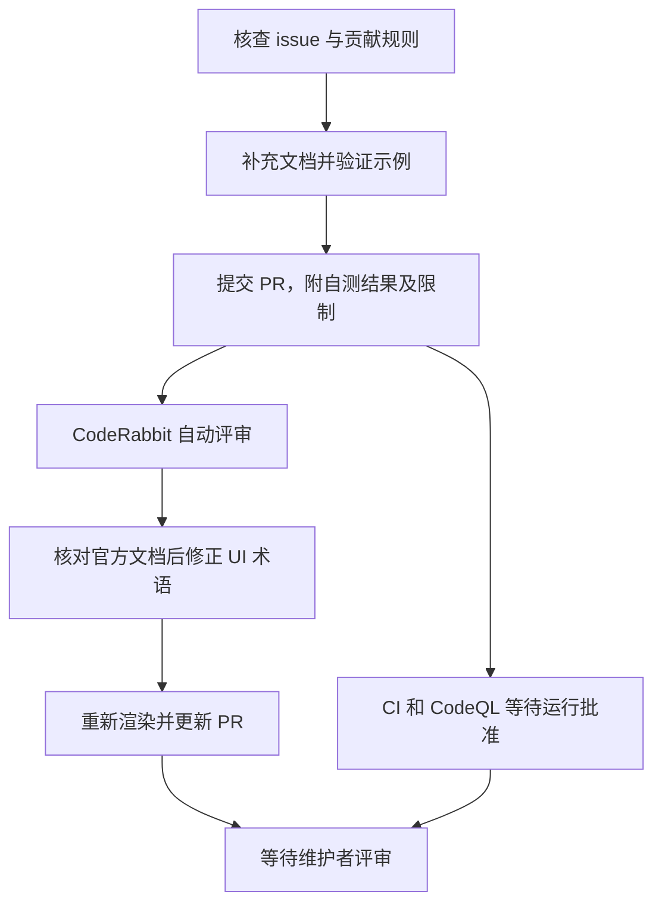

## 这次贡献解决什么问题

[JBang](https://github.com/jbangdev/jbang) 可以直接运行 Java 源文件和 JAR，并帮助处理依赖与运行环境。[issue #2639](https://github.com/jbangdev/jbang/issues/2639) 提出一个使用技巧：启动应用时设置 `visualvm.display.name`，方便在 VisualVM 中辨认进程，希望把它补进文档。

我们把它选作流程热身。问题小、没有服务端部署要求，可以集中验证需求核查、命令测试、文档修改和投稿。

截至 2026 年 11 月 3 日，[PR #2697](https://github.com/jbangdev/jbang/pull/2697) 仍为 Open，尚未合并。下文是投稿阶段的记录。

## 先核查，再决定改哪里

实现前检查了 issue 状态、评论、指派、时间线和同题 PR，没有发现正在处理该题的贡献者。随后阅读贡献指南、Agent 指南和现有文档。

Running 页已有 Flight Recorder 诊断说明，因此在附近新增 VisualVM 小节比较自然。补丁增加 13 行，说明启动参数、进程所在位置，以及同样适用于 JAR 文件。页面位置仍需维护者认可。

核心示例是：

```sh
jbang run -Dvisualvm.display.name=My-Java-App myapp.java
```

应用运行期间，可以在 VisualVM 的 Applications window 中，在 Local 下查找指定名称。

## 自测分成几层

这道题的生产代码没有变化，但文档中的命令仍需要验证。

| 验证层次 | 实际做了什么 | 能证明什么 |
|---|---|---|
| 参数传递 | JBang 0.143.0、macOS x86_64、Java 8u261 运行探针，读取并断言系统属性 | 源文件方式启动后，目标程序收到指定名称 |
| JAR 用法 | 导出探针 JAR，用相同参数运行 | 文档关于 JAR 的说明成立 |
| 对照检查 | 不加属性时读取为空；使用 `jcmd` 检查长驻探针的参数 | 属性来自此次启动配置，且位于目标 JVM |
| 文档渲染 | 使用 Asciidoctor.js 4.1.1 渲染修改页面，检查新增链接和 `git diff --check` | 单页可以渲染，链接可访问，改动无空白错误 |

探针的关键检查很简单：

```java
String name = System.getProperty("visualvm.display.name");
if (!"My-Java-App".equals(name)) {
    throw new AssertionError("Unexpected display name: " + name);
}
```

我们没有实际观察 VisualVM GUI，也没有构建完整 Antora 网站或运行完整 Java 测试套件。VisualVM 官方源码对该属性的支持提供了额外依据，但不能据此声称界面已经验收。这些限制都写进了 PR 正文。

本机 Java 8 足以运行该发行版；源码构建指南要求的 JDK 是另一个问题。这次没有为了文档改动而构建整个项目。

## 自动评审提出了一处有效修正



CodeRabbit 指出，原文把 Applications 写成了 tab，官方名称是 window。我们对照 [VisualVM 官方说明](https://visualvm.github.io/docs/applications_window.html)确认后修正，再次渲染页面并更新 PR。最新一轮自动评审通过。

这个建议很小，却也说明参数验证覆盖不到所有文档表述。自动评审补充了检查视角，我们仍需要核实它引用的事实。

## 为什么 CI 看起来停住了

上游的 `ci-build` 和 `codeql-analysis` 显示 `action_required`，没有开始具体任务。这种状态通常出现在外部贡献的工作流需要维护者批准运行时。它与编译或测试已经失败不同；也不能算作检查通过。

贡献者此时需要识别状态、等待有权限的维护者处理。更新文档并不会自动解除审批要求。机器人审阅通过，也无法替代这一步。

PR 还提示分支落后于 main，但能够无冲突合并。是否必须同步由仓库规则和维护者要求决定；这次先不为消除提示反复更新分支。

## 人在这次热身中参与什么

Agent 承担了调查、补丁、参数验证、渲染和反馈修正。我选择了任务，理解贡献内容与验证限制，并确认以自己的账号投稿。

这次技术改动很轻，适合验证投稿流程。后续更需要学习的是具体仓库的模块和方案取舍，让人工参与逐步深入。PR 是否被接受以及维护者提出什么问题，仍是尚未完成的学习部分。

协作方式与选题方法见[AI 辅助开源贡献：从选题到投稿的协作流程](./2026-11-03-AI辅助开源贡献协作流程.md)。
