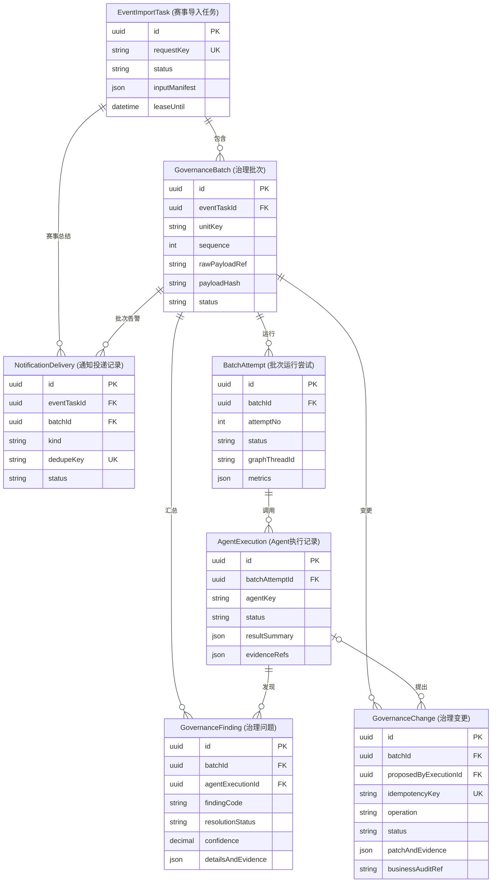
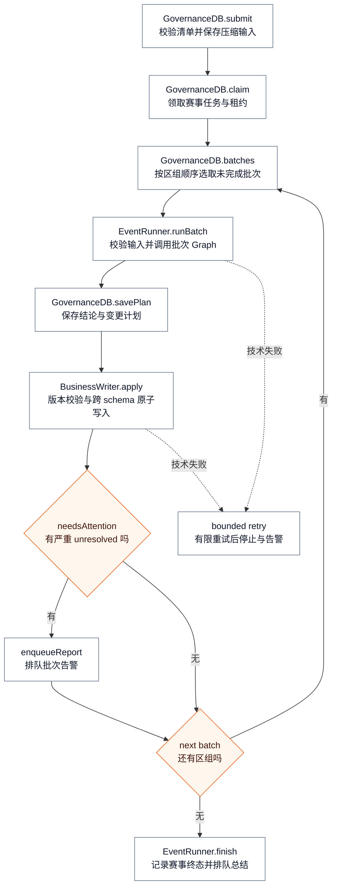
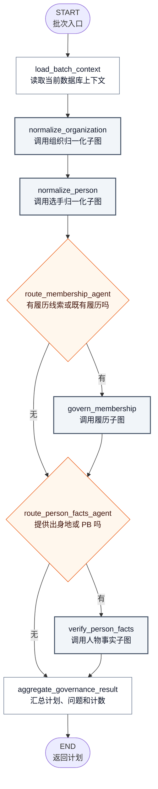
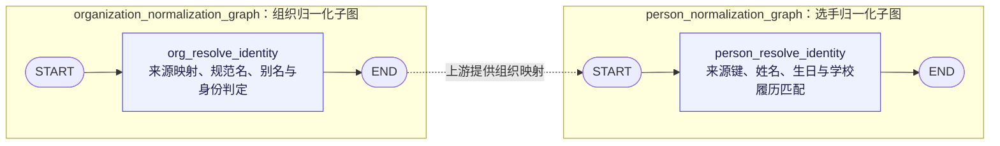
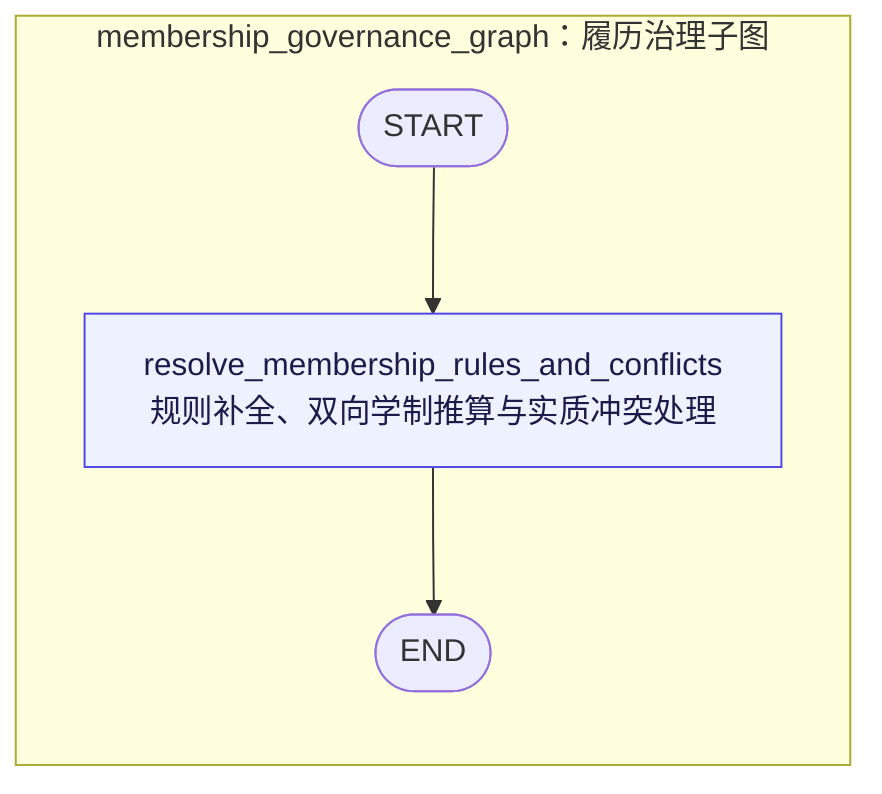
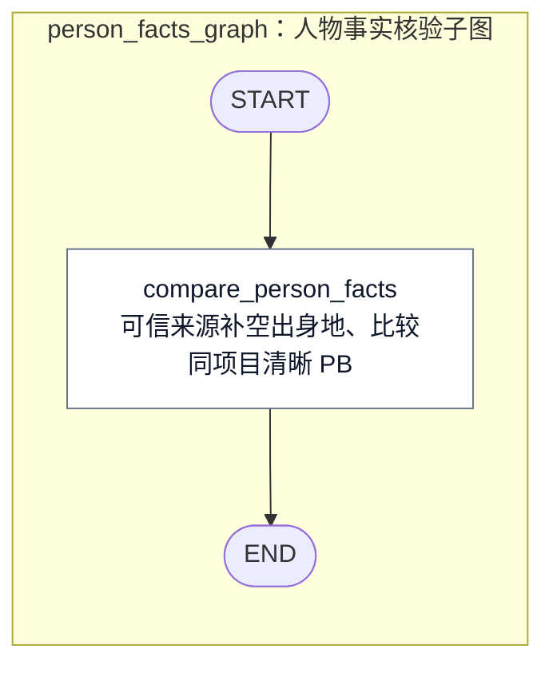
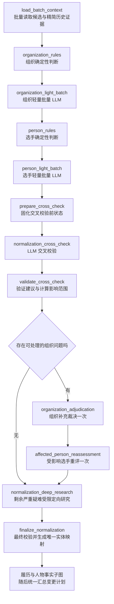

# 襷の系譜：数据治理 Agent 技术方案

版本：1.1 实现修订（首版实现说明 + 2026-11-12 本地完成的归一化改造）  
依据：[数据治理 Agent 产品需求文档](./2026-11-11-襷の系譜-数据治理Agent产品需求.md)

本文给出新治理系统的技术架构、概念数据模型、Graph 边界、导入写入协议、观测与通知设计。新模型完全按当前需求设计，不受旧 Agent 表、字段、枚举或旧数据兼容要求限制。本文模型已落实为主站 Prisma schema 和 SQL migration；实际入口为 Agent 仓库的 `src/governance-v2/cli.ts`。

状态说明：第 4 节既有 Graph 和第 12—14 节记录首版实现及当时验证状态；第 4.1 节为本轮实现，在归一化顺序、批处理和反馈机制方面优先于首版描述。新节点已在本地注册并完成隔离验证，尚未部署、未重跑第 333 回首组；实际模型效果待验证。

设计演进及效果对照见[数据治理 Agent 优化记录](2026-11-12-襷の系譜-数据治理Agent优化记录.md)。本文维护当前技术设计；优化记录保留触发 case、选择原因、优化前基线与后续实际验证结果。

## 1. 架构目标

- 一场赛事作为一个赛事导入任务，内部按区/组顺序运行多个治理批次。
- 治理批次是可独立重试、观测和汇报的最小业务运行单元。
- 选手/组织归一化、履历治理、人物事实核验各自有明确子图和输入输出；runner 负责确定性调度，不使用 LLM 编排。
- 原始输入、判断、证据和实际写入分开记录，能解释“收到什么、Agent 怎么判断、最终改了什么”。
- 数据库写入可重试且幂等；进程故障不会导致导入丢失或重复执行破坏性动作。
- 网络研究只用于选手/组织的严重归一化疑难和无法按规则解释的 Membership 冲突。

## 2. 系统边界

```text
导入工具 / 导入 API
        │ 赛事导入任务：赛事元数据 + 分区/分组 payload
        ▼
赛事任务 Runner ─────── 治理运行库
        │                   ├─ 任务、批次、Agent 执行
        │                   ├─ findings、证据、数据变更
        │                   └─ 通知投递记录
        │
        ├─ 按顺序启动区/组治理 Graph
        │       ├─ 选手归一化子图
        │       ├─ 组织归一化子图
        │       ├─ Membership 子图
        │       └─ 人物事实子图
        │
        ├─ 读取当前主站业务数据
        ├─ 按批次写入主站业务数据及业务审计
        └─ 通过邮件提供方发送批次告警 / 赛事总结
```

### 职责边界

- **导入适配层**：接收既有导入 payload，保留原始数据和来源，解析赛事、区/组及来源行键；不承担实体治理判断。
- **赛事任务 Runner**：创建赛事任务、按区/组顺序推进、处理重试和赛事级完成通知。调度逻辑为普通程序代码。
- **治理 Graph**：针对单个区/组执行领域判断，返回结构化结果、证据引用、问题和待写变更。
- **写入执行器**：校验变更计划、幂等键和目标版本，更新主站业务数据，写入业务审计，并返回变更结果。
- **治理运行库**：保存治理任务生命周期和诊断细节；不作为选手、组织、Membership 等业务事实的权威来源。
- **主站业务库**：治理完成后的业务数据权威来源；继续使用业务模型和业务审计机制。

### 赛事基础结构准备协议

本机依据官方资料生成赛事结构输入，通过主站确定性准备脚本直接写入业务库。该步骤位于 `EventImportTask` 提交之前，不调用治理 Graph。治理入口要求 `CompetitionEdition`、该批 `Race` 与 `Source` 已存在；输入引用必须对应同一届次和正确区/组，不能仅凭 slug 存在就视为有效。

执行顺序：核对生产连接与现有结构 → 保存官方来源和结构输入 → 输出新增/复用/修改差异 → 执行结构写入 → 回查结构及关联 → 准备单组 manifest → dry_run → 复核治理计划与指标 → apply → 核验后推进下一组。dry_run 只约束治理任务，不撤销此前已经提交的赛事结构。

准备脚本仅允许处理赛事系列、届次、日期、地点、项目、区/组及来源；复用既有稳定标识，重复执行不得重复建组，不以缺失输入覆盖已有可靠字段。普通日体大赛事与 NCG 保持独立竞赛语义，按照官方来源核对其届次、项目和组别映射。选手、组织、Membership、PB 和成绩全部留给治理批次处理。

准备阶段保留来源 URL、输入文件、执行目标（不含凭据）、计划差异、实际变更标识与回查结果；不得把本机手工分析描述为 Agent 自动治理。准备失败时先检查实际已提交结构再修复，不假定准备脚本天然具备整场事务或审计能力。准备耗时单列，不计入治理任务 summary。

以上为准备入口的验收要求；现有脚本需按目标赛事核对后才能执行，文档更新不代表准备脚本已经全部满足要求，也不代表生产结构或成绩已经写入。

## 3. 精简模型设计（首版）

目标是留足运行恢复、判断追溯和业务变更审计所需的信息，不把每条导入行、每份证据和每次内部节点状态都永久复制进治理数据库。



`通知投递记录` 必须且只能关联赛事导入任务或治理批次之一；数据库以 XOR check constraint 保证。

`GovernanceFinding` 与 `GovernanceChange` 是同一批次中的独立记录，不要求一一对应：规则正常推算或补全可以产生变更而没有问题；发现 unresolved 也可以暂时没有可执行变更。

| 模型名（中文表名）                     | 用途                                                                            |
| -------------------------------------- | ------------------------------------------------------------------------------- |
| `EventImportTask`（赛事导入任务）      | 跟踪整场赛事的接收、排队、分区/分组处理和赛事总结邮件。                         |
| `GovernanceBatch`（治理批次）          | 表示一个区或组；保存顺序、原始 payload 引用、内容 hash 和治理结果。             |
| `BatchAttempt`（批次运行尝试）         | 记录批次的初次运行、恢复或重试；保留状态、错误摘要、checkpoint 引用和资源统计。 |
| `AgentExecution`（Agent执行记录）      | 记录各 Agent 在一次 attempt 中的版本、状态、结果摘要和引用证据。                |
| `GovernanceFinding`（治理问题）        | 记录严重疑难、普通修复判断或 unresolved；证据摘要随问题以 JSON 保存。           |
| `GovernanceChange`（治理变更）         | 记录一项业务变更计划及实际状态；保存精简 patch、证据引用和主站 AuditLog 引用。  |
| `NotificationDelivery`（通知投递记录） | 跟踪批次告警/赛事总结邮件的去重、发送状态和重试。                               |

### 核心字段与约束

- **EventImportTask**：`id`、`requestKey`、来源/赛事业务引用、`status`、输入清单、summary、调度时间、worker lease/heartbeat、开始/完成时间和错误摘要。`requestKey` 唯一，任务行兼任数据库队列入口。
- **GovernanceBatch**：`id`、`eventTaskId`、`unitType/unitKey`、`sequence`、`rawPayloadRef`、`payloadHash`、记录数量、状态和 summary。一个赛事任务内的区/组键及顺序唯一。
- **BatchAttempt**：`id`、`batchId`、attempt 序号、触发类型、输入指纹、状态、checkpoint thread ID、开始/结束时间、错误摘要和聚合 metrics。`(batchId, attemptNo)` 唯一。
- **AgentExecution**：`id`、`batchAttemptId`、Agent 稳定代码/版本、状态、输入摘要引用、结果摘要、证据引用、LLM/网络调用计数与耗时。完整 prompt、完整 graph state 和逐节点 trace 不放在此表。
- **GovernanceFinding**：`id`、`batchId`、Agent 执行引用、问题代码、对象类型/引用、severity、resolved/unresolved 状态、置信度、简短理由和 `detailsAndEvidence` JSON。通常只为有问题或需要解释的判断建行，不为每条正常数据建 finding。
- **GovernanceChange**：`id`、`batchId`、提出它的 Agent 执行、稳定 change key/revision、幂等键、动作、实体引用、状态、写入 patch、必要的 before/after 字段差异、证据引用、合并/拆分影响对象、执行计数、错误摘要和主站 AuditLog ID。成功业务审计以主站 AuditLog 为准，不复制完整业务实体快照。
- **NotificationDelivery**：`id`、赛事任务或治理批次、邮件类型、dedupe key、结构化邮件 payload、状态、尝试次数、下次尝试时间、发送时间和错误。必须且只能设置 `eventTaskId`、`batchId` 其中一个。

稳定代码（Agent 类型、finding code、operation、区/组类型）使用应用层 catalog 校验；状态使用有限枚举。字段级证据和不同 Agent 的补充信息放 JSON，但 ID、外键关系、状态、幂等键、输入 hash 和时间戳保留为独立列以便查询和约束。

### 保留与体量控制

- 原始 payload 每个区/组仅保留一份不可变压缩对象；治理库保存 URI、字节数和 hash。禁止同时逐行再写一份导入行 JSON。
- 证据只保留来源 URL/行键、抓取时间、短摘录、hash 和必要元数据；不默认持久化完整网页、PDF 或整份数据库快照。
- Finding 和 Change 只记录非平凡问题/实际变更；普通无异常字段不逐项生成治理记录。
- `GovernanceChange` 保存变更字段 patch，不复制整个 Person、Organization 或 Membership；合并/拆分保存受影响 ID 清单或压缩引用。
- LangGraph checkpoint 是恢复数据，不是永久审计数据。批次终态且超过恢复窗口后清理 checkpoint；窗口长度在上线运维方案中设定。
- 完成的原始 payload 和低频诊断详情按保留策略归档或过期清理；任务、批次汇总、unresolved、已应用变更索引和业务 AuditLog 引用长期保留。
- 首轮上线前统计真实 payload 大小、checkpoint 增长和典型赛事批次数，再定保留期限与对象存储生命周期；目前不声称模型一定比业务站点数据小。

### 状态与索引

| 模型                   | 建议状态                                                                           |
| ---------------------- | ---------------------------------------------------------------------------------- |
| `EventImportTask`      | `queued`、`running`、`completed`、`completed_with_unresolved`、`failed`            |
| `GovernanceBatch`      | `queued`、`running`、`completed`、`completed_with_unresolved`、`partial`、`failed` |
| `BatchAttempt`         | `running`、`succeeded`、`partial`、`failed`、`superseded`                          |
| `AgentExecution`       | `running`、`succeeded`、`skipped`、`partial`、`failed`                             |
| `GovernanceFinding`    | `resolved`、`unresolved`、`informational`                                          |
| `GovernanceChange`     | `planned`、`applying`、`applied`、`failed`、`superseded`                           |
| `NotificationDelivery` | `pending`、`sending`、`sent`、`failed`                                             |

- `EventImportTask(requestKey)`、`GovernanceBatch(eventTaskId, unitType, unitKey)`、`GovernanceBatch(eventTaskId, sequence)` 唯一。
- `BatchAttempt(batchId, attemptNo)`、`AgentExecution(batchAttemptId, agentKey, executionNo)`、`GovernanceChange(batchId, changeKey, revision)` 唯一。
- `GovernanceChange(idempotencyKey)`、`NotificationDelivery(dedupeKey)` 唯一。
- Worker 查询索引覆盖任务状态/下次运行时间/lease 到期；批次按赛事任务和 sequence 查询；问题按 severity/resolutionStatus 查询；变更按 batch/entity/status 查询。

### 已确定的数据库边界

治理模型放在主站 PostgreSQL 的独立 `governance` schema。治理表与业务表不建立业务实体强外键；写入执行器使用同一 PostgreSQL transaction 跨 schema 写业务记录、业务 AuditLog、GovernanceChange 状态和 cache invalidation outbox，以保证同库原子提交。

## 4. 调度与 Graph

### Mermaid 节点表示约定

矩形是实际 `addNode` 名称，第一行为英文名称，第二行为中文说明；菱形是条件路由函数，不是独立节点。`START`、`END` 是 LangGraph 内置边界。白色表示规则/数据处理，灰色表示子图调用，紫色表示规则优先、必要时受限调用 LLM 的混合节点，橙色表示路由。研究请求是混合节点内部工具调用，不另画成不存在的 Graph 节点。

### 赛事级 Runner

本图展示普通程序方法，不是 LangGraph 节点。输入先完整保存，各批按 sequence 顺序推进；本批治理并提交后下一批重新读取业务库。技术失败有限重试后停止后续批次；unresolved 正常写入并继续。



业务事务同时更新批次完成状态；收尾中断后 runner 识别已完成批次，只补 attempt 状态和通知，不重复写业务数据。

### 治理批次 Graph

名称：`governance_batch_graph`。以下为首版图，矩形与首版代码注册节点对应；改造后的归一化阶段见第 4.1 节。写入由 Graph 外的 runner 执行，Graph 只输出计划。



### 选手与组织归一化 Agent

归一化是一个职责组，内部有两个顺序执行的子图。首版每个子图保留一个领域节点；精确匹配、候选筛选、规则与受限研究在节点内部完成，不为每个 helper 增加 checkpoint。紫色不表示每次都会调用 LLM。



- 来源映射、精确别名和明确履历上下文先用规则。已有高中履历可帮助识别新大学记录；当前学校的明确时间线明显矛盾时不自动归入同名档案。
- 普通组织简称可作不联网的受限语义判断，确认后保留别名。
- 竞争归属会实质影响选手/组织身份时才允许网络研究。合并/拆分要求证据与指定关联范围，成绩或队伍关联碰撞先保留 unresolved。
- 无法确认候选时建立来源限定的独立实体，保留证据，不随意归入某个候选。后续仍可治理。

### 履历 Agent



节点先合并本批证据与受影响人物的存量履历：同关系无新信息跳过；允许日期未知；高中结束明确可推算已确认大学关系，大学开始明确可反推已确认高中。学年只适用于对应学校，推算日期标为 inferred，不证明毕业。来源日期可纠正推算日期，推算不会覆盖来源日期。多段同阶段学校关系不盲目套完整学制。

普通新所属不触发网络，也不自动结束旧所属。只有来源日期互相冲突、明确互斥的关系存在实际重叠等严重问题才进入定向研究；证据不足保留当前结果、来源与 unresolved。

### 人物事实核验 Agent



该节点完全是规则处理，不调用 LLM/网络。普通空字段、模糊 PB、未知项目、来源可靠度不足均跳过；PB 只接受同项目可比且更好的值。合并人物时先综合两个档案已有 PB 再比较，避免覆盖较好成绩。已有出身地不由新来源随意覆盖。

### 子图输入输出契约

共同 state：`batchId`、`input`、`context`、`mode`、`resolution`、`membership`、`facts`、`plan`。组织输出 organizationMap；选手追加 personMap；履历与事实输出 AgentResult；聚合输出 Plan。AgentResult 含 agentKey、skipped、findings、changes 和 metrics。持久 checkpoint 由父图 PostgresSaver 传给子图；领域审计另存七张治理表。

## 4.1 两轮归一化与有界交叉校验（本地实现，待上线验证）

### 决策依据与取舍

产品原因见 PRD“两轮归一化与有界交叉校验”。技术检查发现：首版组织主要依赖来源映射、名称/别名规则及逐项受限研究；人物确认主要依赖来源映射、Membership 上下文和明确生日。历史 RaceResult 所属未直接进入人物规则匹配，一些研究上下文只在研究触发后补取，因此“没有 Membership”会使已有历史成绩证据无法参与前置判断。第 333 回第 1 组的 17 条待确认不能直接视为冲突或可合并对象。

本轮采用精简证据召回、批量轻量语义判断和一次有界交叉校验。相较给具体学校硬编码字符串替换，已确认别名更适合保存实体特例；相较两个 Agent 互相调用直到收敛，固定 DAG 更便于限制成本、恢复和解释。LLM 负责证据语义判断，代码负责调度、范围、预算和写入许可。

### 目标 DAG 与阶段边界

以下节点已在本地实现，不代表当前线上节点。替换首版组织/选手归一化段，随后接原有履历、人物事实和计划汇总；整图无返回边。空阶段由节点内部跳过，不一定使用条件边。



- 规则充分解决的对象不进入轻量调用。轻量阶段模型无 web_search 工具，保持来源对象键，不跨区/组混批。组织、人物分别将本组全量 unresolved 各请求一次；不拆小批，不新增批量大小、并发或超时配置。继续使用既有模型与超时配置；整组输入设固定 512000 字符防护，超限停止，不暗中拆批。
- `prepare_cross_check` 固化本阶段状态；交叉校验一次读取本组组织、人物映射、暂定判断与证据 catalog。代码随后检查对象范围和证据引用；空组跳过，不拆批。语义依赖由 LLM 审查，当前没有完整的自动依赖分析器。
- `organization_adjudication` 先执行已足够的确定性校验；需语义判断时使用无网络受限 LLM。它只能裁决交叉校验列出的组织问题，不能新增自由任务。证据不足留给深入研究，不把建议直接视为已确认别名。
- `affected_person_reassessment` 根据实际变更的组织映射选人，先规则后必要的轻量判断；未发生变化不重评。只有受影响 unresolved 进入一次模型重评，不能再次触发交叉校验或组织裁决。为同步撤销暂定计划，内部会从不可变输入重建确定性计划投影，仍遍历本组，但不触发额外 LLM 调用。
- 第二轮 `normalization_deep_research` 集中处理剩余严重归一化疑难，复用受限研究工具；普通缺字段不触发联网。研究输出也接受最终一致性检查；若导致新的跨实体矛盾，不回跳、不盲目传播，将相关不确定关系保留为 unresolved。Membership 实质冲突仍由其领域子图处理。
- finalization 前只维护临时结果，校验一个来源对象仅有一个最终目标、候选范围、证据依赖和关联碰撞。替换暂定映射时，旧 create/alias/source_mapping 等计划必须被撤销或 superseded，不得把暂定新建与最终匹配同时写入；下游只消费最终映射。

### 证据与结构化契约

新增精简 evidence catalog：来源对象、历史 RaceResult、SourceReference 和 Membership 记录键及对应资料。历史成绩和来源引用每人最多读取 11 条，第 11 条同时作为超过 10 条的截断标识；不能把未召回等同于不存在。整组输入超限停止，不拆批。DNS 作为报名线索与实际出场分开；普通赛事/NCG 与具体组别保留原始语义。历史所属可以提供证据，不自动创建 Membership 或补年级。人物匹配必须引用属于目标候选的历史记录，或有明确一致生日；仅有来源行或相似姓名不足以确认。

轻量判断逐项输出 `itemKey`、`verdict: match|distinct|unresolved`、受允许候选集合约束的 `targetId`、`evidenceRefs`、`reason`；批量响应必须与请求对象一一对应，校验重复、遗漏和越界 ID。合并/拆分不能仅凭该轻量响应执行，仍需专门证据、影响范围及计划校验。

交叉校验输入包含本组来源行、组织和人物暂定判断、映射、候选与证据 catalog；批次关联、请求指纹和策略版本由运行上下文及日志保存。输出每项 `issueKey`、`issueType`（组织变体、映射矛盾、循环证据、资料不足）、相关组织/人物对象键、`evidenceRefs`、`reason` 和 `suggestedAction: keep|review_organization|research|unresolved`。它输出的是审查建议，不是直接执行的 merge、split 或任意工具调用。

代码必须验证所有对象和证据引用存在、动作在允许集合内，组织修正有独立证据支撑，不能以待确认同人结论证明组织等价、再反向证明同人。LLM 自报置信度不能绕过这些校验。对无法由代码充分识别的语义循环，模型必须明确指出前提，缺少独立证据时按 unresolved 处理，不宣称已能自动发现所有循环论证。

### 预算、恢复与异常

新增 `normalizationPolicyVersion`，策略版本及模型、endpoint 纳入请求复用键。全部阶段计入实际调用、tokens、耗时与费用；新增无网络阶段固定最多 5 次物理请求（组织、选手、交叉校验、组织裁决、受影响重评），不新增配置项。深入研究沿用既有默认 3 次额度，含履历研究。技术重试也消耗物理请求额度，跨 attempt 持久累计。

逻辑重评上限为一次，与网络/模型技术重试分别计量；技术重试必须有限。LLM 结论、输入指纹、已消耗预算及当前阶段随 checkpoint/运行记录保存；恢复时复用同指纹已完成结果，不因恢复重置预算。复用键包含来源对象、候选/证据版本、规则/prompt/模型版本和策略版本；上下文改变不可误用旧结论。不承诺崩溃前响应未持久化时模型请求恰好一次，仍要记录重试成本。

正常证据不足、预算耗尽可按已验证结果和来源限定实体继续，标记 unresolved 与停止原因；无相关对象标记 skipped。超时、非法结构化输出、存储或程序错误分别记录技术错误，不能伪装成业务“已确认”或“证据不足”。仅在确定性兜底能通过最终校验时以 degraded/partial 明确继续，否则按技术失败停止该批并允许恢复。

### 观测与验收

阶段使用 Graph checkpoint、当前节点和归一化 Agent metrics 内明细追踪；不为每个节点新建独立 AgentExecution。LLM 请求日志关联 stage、callId 和对象数。保留物理调用与逻辑对象判断两种计数；实际 tokens/费用按请求计，不将一次批量请求算成多次调用。

新增指标：轻量判断、交叉校验、裁决、重评及深入研究的输入/解决/剩余数与耗时、请求对象数、交叉问题数、组织修正数、受影响及模型重评人数、受影响对象最终解决数。保留规则判断次数、策略版本、最终 unresolved 和 planned/applied。交叉校验和深入研究暂不单独归因解决数，记为 0；受影响对象最终解决不等于组织修正的因果收益，需结合计划复盘。阶段解决数不累加为最终人数。未取得 usage 或价格时费用为空，不显示为零。

每轮由用户主导复盘：检查可解释但未编码的判断，区分通用规则、实体别名和仍需语义判断的事项。在现有规则 catalog/版本记录中登记条件、反例、证据、回归用例与收益；本轮无可沉淀项也可正常结束，不要求自动另生成报告。已确认实体别名通过正常计划写入，不自动从模型输出生成通用规则代码。

研发验收至少覆盖：

1. 有独立证据的组织变体批量判定；无证据相似名称仍 unresolved，不引入“第1/一/大一通用替换”。
2. 同名同所属历史成绩但无 Membership 的候选进入证据上下文；同名不同人、生日矛盾、学校变更和 DNS 反例不误合并。
3. 选手阶段暴露组织问题，补充裁决后只重评受影响对象一次；无实际映射变化不重评，循环证据不能通过。
4. 批量响应遗漏/重复/越界、预算耗尽、超时、checkpoint 恢复及上下文失效；技术错误与业务 unresolved 可分别观测。
5. 暂定新建被最终匹配替换时无多余创建或来源映射；同组最终计划可解释、幂等，dry_run 不写业务数据。
6. 在相同不可变输入与明确的数据库快照/版本上比较旧新 dry_run，保留调用量、tokens、耗时、费用、unresolved 和变更差异；旧流程结果不作为正确性的唯一标准。用户确认本组观测后再推进后续组，不由操作者手动匹配来制造改进。

本节对应的 context、分阶段 Graph、批量模型适配、持久预算及模型日志、计划重建与观测投影已在本地实现。隔离测试验证节点、证据、故障恢复及业务写入边界。尚未部署、未使用真实模型验证本轮 prompt、未重跑第 333 回首组；不能据此声称成本、耗时或 unresolved 已改善。

## 5. 写入、幂等与一致性恢复

当前主站导入器逐条写入 race entries 和 team results；外层失败时可能留下前序已写数据。因此新流程以“治理批次”为清晰的持久化和恢复边界，并在技术实现阶段验证批量事务是否可行。

### 写入协议

1. 在治理运行库持久化完整输入引用、Agent 结论和 proposed changes。
2. 写入前从主站重新读取变更目标及必要关联，校验计划基于的数据仍有效；若目标已变化则重新评估该批计划，不覆盖较新的可靠数据。
3. 为每个业务变更生成稳定幂等键，键包含治理批次、来源行/实体、动作类型和目标；重试先查询已成功动作。
4. 在同一个 PostgreSQL 事务中，原子执行一个区/组的业务写入、SourceReference 更新、业务 AuditLog、GovernanceChange 的 applied 状态和缓存失效 outbox 记录。首版不分段；若真实试点证明事务过大，再单独调整。
5. 事务提交后，runner 汇总提交结果并推进批次/赛事任务状态；若进程在提交后、更新高层任务状态前崩溃，重试读取已 applied 的变更继续收尾，不重复执行创建、合并或删除动作。

要实现跨 schema 原子事务，写入执行器必须通过同一个 PostgreSQL connection/transaction 访问业务 schema 和治理 schema；两个独立 Prisma client 各自开事务不满足此保证。实现时选择一个能同时访问两 schema 的 transaction client，或在同一事务 connection 中执行受控 SQL。

### 一致性原则

- 治理 schema 与业务 schema 位于同一个 PostgreSQL 数据库；业务变更、业务审计和变更执行状态使用单数据库事务。外部模型调用、邮件和缓存刷新不纳入数据库事务，以幂等 outbox/重试完成。
- 原始输入先落到可恢复存储，再进入分析；Agent 或网络调用失败不能导致输入丢失。
- unresolved 是治理结论状态，不是写入阻断状态；但确实无法生成有效业务归属时，写入原始成绩/来源载荷和当前最合理结构，实体映射同时保留疑难状态，具体业务表达需按主站模型验证。
- 合并/拆分写入要锁定受影响实体或使用版本校验，事务内迁移关联记录、来源映射和业务审计；执行前后核对影响数量。
- 缓存失效在业务事务成功后可靠触发；建议通过事务 outbox 或可重放失效事件避免提交成功但缓存未清。

## 6. 研究调用与资源控制

- **结构化规则优先是首版实现原则**：已有输入可以通过明确规则、数据库查询或数值计算得出结论时，由确定性代码执行，不调用 LLM。包括来源 ID/别名精确匹配、字段有无与格式校验、项目和单位换算、可比 PB 数值比较、学制与时间锚点推算、只补空值、关系类型互斥与时间区间检查、研究触发条件和预算判断。
- **LLM 只处理规则未覆盖的语义判断**：例如复杂姓名/组织身份消歧、非结构化证据理解，以及规则无法解释的实质履历冲突。先执行规则；规则已得出充分结论的项目不送 LLM，仅将剩余疑难及必要上下文交给模型。规则检查发现冲突不等于必须调用 LLM 或联网，仍遵守研究范围限制。
- **图中类型边界**：白色节点包含确定性业务规则；紫色表示需要模型判断的路径，内部仍先检查规则是否已能得出结论；灰色加粗边框表示子图调用，不代表一次 LLM 请求。人物事实比较与学制推算不默认调用 LLM。
- **本轮已确认改造**：归一化的批量轻量判断与有界交叉校验按第 4.1 节研发，不再仅列为后续优化；其他跨项目批处理、并发调优和模型切换仍根据观测验证。当前即可实现的明确规则和无关子图跳过照常落实。
- 网络研究只允许由选手/组织的严重归一化疑难和 Membership 实质冲突节点触发；普通字段缺失、普通所属、PB 不清晰不触发。
- 子图先用确定性规则和已存证据筛选；研究输入必须包含要解决的问题和已有候选，避免开放式泛搜。
- 每次研究记录 provider/model、请求类别、耗时、token/费用（可获得时）、来源 URL、结果和停止原因。
- 研究有批次级和单问题级预算；超预算转 `unresolved`，照常按最佳当前结果写入。
- 网络失败与“已查无结果”区分；临时失败可重试，确定无结果可按输入指纹短期复用，避免同批重复查询。
- 性能优化顺序：先减少不必要子图与外部调用，再复用批次级查询/数据库读取，然后根据测量结果做模型或并发优化。

## 7. 报告、站点观测与通知

- 站点观测以 `EventImportTask → GovernanceBatch → AgentExecution → Finding/Change` 作为导航层级，可下钻证据和写入前后摘要。
- 治理批次邮件只对需要关注的问题发送：严重身份疑难、无法解释的 Membership 冲突、Agent/写入失败等；普通规则修复不单独发信。
- 赛事任务结束后无条件发送赛事汇总邮件，说明导入了什么、完成哪些治理/修复、统计数量和仍 unresolved 的事项。
- 通知通过持久化投递队列/记录执行，支持失败重试和去重；相同批次相同告警不重复轰炸。邮件发送失败不回滚已成功的业务导入，但赛事任务的通知状态保持待重试。
- 邮件模板只由结构化 finding/change 汇总生成；unresolved 描述使用自然语言解释问题、当前采用结果和停止继续研究的原因。

### 7.1 首批导入前必须具备的指标

观测是首批真实导入的前置条件。第一阶段不要求独立指标平台，使用 `EventImportTask.summary`、批次/attempt/AgentExecution 的现有记录和个人站只读投影即可，但字段语义必须固定：

| 维度 | 指标 | 口径 |
| --- | --- | --- |
| 性能 | `eventDurationMs`、`queueWaitMs` | 任务创建到终态；创建到首次 attempt 开始 |
| 性能 | `attemptCount`、`retryCount`、`attemptDurationMs`、`retryDurationMs` | 按批次 attempt 汇总；重试为 `attemptNo > 1` |
| 性能 | Agent duration | 各 Agent metrics 的累计执行时间；允许大于赛事墙钟耗时 |
| 成本 | LLM/network calls、input/output tokens、model、estimated cost | 统计全部实际模型请求，含轻量及交叉校验；未获得 usage 或价格时费用为空，不伪造精确成本 |
| 成本 | cost per imported/planned row | 分母为已完成批次累计行数；分母为零时为空 |
| 效果 | resolved/unresolved、rule decisions、planned/applied changes | finding 按状态统计，change 按操作统计，重试不重复累计已完成批次 |
| 稳定性 | task/batch/attempt/Agent/notification status | 以数据库状态和投递记录为准，不能用日志推断成功 |

事件 summary 在任务完成时间写入后生成，保证总耗时可计算。旧任务或 dry-run 没有足够数据时展示空值；空值不转换为 0。当前个人站已展示赛事 summary、批次和 Agent metrics，但 `BatchAttempt` 尚未作为独立页面层展示；因此首批导入前仍需补齐批次/attempt 明细下钻，不能把现有赛事汇总页称为完整的四层观测界面。

### 7.2 观测后的优化实验口径

首批按区/组顺序完成基线后，再逐项评估优化：

1. 先检查确定性规则是否可以提前剪枝，比较 LLM/network calls、unresolved 和最终变更结果。
2. 再检查同一批次内的数据库上下文读取、研究结果和重复候选是否可以复用，比较墙钟耗时与 tokens。
3. 本轮已根据首组证据确认第 4.1 节的归一化批处理和交叉校验改造；并发调优或模型切换仍待瓶颈测量，不得绕过赛事内顺序和批次隔离。

每个优化实验必须保留优化前后相同赛事类型或可解释的对照批次，并同时比较调用次数、tokens、估算费用、墙钟耗时、重试、resolved/unresolved、实际变更和数据正确性。只降低成本但增加 unresolved 或改变业务结果的方案不能直接采用。

## 8. 安全、权限与运行保护

- 读写数据库连接分离；Agent 读取使用只读凭据，业务写入由单独受控执行器使用最小写权限。
- 生产写入由明确的部署配置启用；不得因 dry-run 或诊断路径意外写入业务数据。
- 所有写入均有审计和幂等保护；禁止 LLM 生成可直接执行的任意 SQL。
- 日志中避免输出连接凭证和无关个人数据；证据摘录按最小必要范围保存。
- 高影响合并/拆分的自动执行依赖结构化决策和校验，不以单一置信分数代替业务规则与证据要求。

## 9. 验证策略与阶段

### 阶段一：框架落地

- 落实独立治理 schema、任务和批次生命周期、持久化 Graph checkpoint、写入幂等键及恢复协议。
- 建立新概念 schema 和最小任务查询/观测接口，不迁移旧运行数据。
- 使用 dry-run 验证一场分区/分组赛事的任务创建、顺序执行、子图跳过和赛事汇总。

### 阶段二：单区/组增量试点

- 接入选定的分区/分组赛事，按批次完成治理与写入。
- 检查人/组织映射、Membership 推算、实际业务变更和审计记录。
- 注入 Graph 中断、业务事务提交后批次收尾中断、邮件发送失败等故障，验证幂等恢复。
- 记录外部请求数、LLM 调用/token、批次耗时、finding 数、自动修复数和 unresolved 数。

### 阶段三：扩展

- 试点通过后扩展到赛事后续区/组，再接更多赛事类型。
- 根据实际误判与调用数据优化剪枝、批处理和模型成本。
- 定向存量扫描作为单独入口设计，复用领域子图但使用不同任务来源，不伪造赛事导入上下文。

### 首批技术验收

- 同一赛事下区/组严格按顺序执行；前一批成功写入的数据可被后一批读取。
- 输入、Agent 结果和实际变更可通过任务 ID/批次 ID 完整追踪。
- 对无相关输入的 Agent 能正确跳过，且不产生网络请求。
- 只有身份疑难或实质 Membership 冲突会触发研究调用。
- 重试不会重复写成绩、重复合并、重复创建 Membership 或重复发送同一告警。
- unresolved 数据仍完成导入；批次告警和赛事总结符合各自触发规则。
- 高中日期未知、大学起始节点明确时能按既有学制反推高中窗口；推算不覆盖可靠来源日期。

## 10. 实施时需要验证的技术选择

以下是实现选择，不阻塞启动详细设计，由开发阶段的本地验证落实；若结果改变产品行为或模型边界，再向用户提出具体决策：

1. **Graph checkpoint**：LangGraph Postgres checkpointer，还是自建节点执行表。推荐先验证 Postgres checkpointer 与治理批次/执行记录的关联方式，领域审计仍由本方案业务表负责。
2. **批次写入事务粒度**：一个区/组全量事务，还是按人员/团队结果一致性组分段。需依据典型批次大小和主站写入行为压测确定。
3. **原始 payload 存储**：按每个区/组一个压缩对象 + hash/URI 的模型实施；上线前确定对象存储提供方、访问控制和保留生命周期。

上述选择与 Prisma 详细 schema、Graph state/node 契约、API/CLI 设计一起落实；开发顺序与验收见第 12 节。

## 11. 当前代码基线观察

- 主站 `importRacePayload` 目前逐条处理成绩和队伍结果；失败后将 ImportBatch 标为 failed，但外层没有覆盖所有写操作的单一事务。
- 主站已有 `ImportBatch`、`SourceReference`、`AuditLog`，可供集成时建立赛事来源关联和业务审计；新治理运行模型不依赖它们的 schema 形态。
- 现有 Agent 服务使用独立 Agent 数据库和只读/可选写入的主站连接；已有选手和组织 LangGraph，但其当前诊断流程包含普通档案/Wikipedia 核验、按人扫描和建议动作模式，需要按新产品边界重新编排。
- 当前工作区有 Agent 仓库未提交改动；本方案阶段只读取代码作为现状依据，不覆盖这些改动。

## 12. 开发前分析与详细实施步骤

### 12.1 当前阶段与授权边界

本节保留已认可的实施顺序。用户已明确要求“开始”，现已完成首版本地实现与隔离数据库验证；生产切换、正式赛事导入和真实邮件发送尚未执行。

首版范围是赛事增量治理完整闭环：接收一场赛事 → 按区/组顺序治理 → 三组 Agent → 当前最佳结果写入 → 观测与报告。结构化规则优先，普通字段不联网；存量扫描、历史兼容、LLM 批量调用及复杂性能优化不进入首版。

### 12.2 已核对的代码与影响

| 位置                                     | 当前行为                                                                     | 实施影响                                                                                   |
| ---------------------------------------- | ---------------------------------------------------------------------------- | ------------------------------------------------------------------------------------------ |
| 主站 `scripts/lib/race-importer.ts`      | 逐条处理 entry/team result，处理前查重，结束后更新缓存版本                   | 新增治理写入入口，以区/组事务为边界；不能把旧导入入口当成已经具备原子性的执行器。          |
| 主站 `scripts/lib/import-utils.ts`       | 同时负责匹配实体、创建实体、补 Membership 和 PB、写成绩                      | 拆开判断与写入；写入器消费已校验的实体映射和变更计划，不在写入途中重新做归一化。           |
| 同文件的学制函数                         | 已有按年级推算、高中结束推大学、大学开始反推高中等函数                       | 提炼成纯规则；逐项核对适用前提，不把所有历史推算默认列为首版规则。                         |
| 同文件的 PB 函数                         | 候选排序先看可靠度、来源时间，再看成绩；实际更新另有“更快且来源条件满足”判断 | 新版统一比较规则，明确更慢 PB 不因来源更新而自动覆盖更好值；来源时间不是成绩发生时间。     |
| 主站 `Membership`                        | 日期/年份可空；`endDate` 注释将空值描述为当前所属；没有独立日期推算来源字段  | 明确未知与仍在职的表达、日期依据和推算标记，避免推算值被下次读取当作来源事实。             |
| 主站维护脚本                             | 已有真实的组织别名、同名混人、学校转学、空时间重复关系处理                   | 用作规则/测试案例来源；提炼通用条件，不直接执行带指定人物 ID 的维护脚本。                  |
| Agent `src/graph/*`                      | `MemorySaver`；另有自行落库的节点 state 快照                                 | 不能仅凭存在快照就声称具备跨进程恢复。用本地中断实验证明新 checkpoint 方案可恢复。         |
| Agent `src/governance/*`                 | 以存量人物为主体；高风险动作可能 held；动作成功后另写执行状态                | 重建赛事/区组调度和同库事务执行，不沿用普遍人工审批或跨数据库提交顺序。                    |
| 个人站 `lib/observability.ts`            | 直接查询旧 `AgentRun`、`GovernanceSubject` 等表                              | 改成新任务层级，限定只读权限与公开字段；无需迁移旧展示数据。                               |
| 主站 `scripts/lib/cache-invalidation.ts` | 使用数据库中的 scope/version                                                 | 核对站点读取机制；若事务内更新版本即足够，直接复用，避免仅为方案中的 outbox 字样增加新表。 |
| 主站 `scripts/lib/import-scope.ts`       | 明确排除第 103 回箱根预选赛事导入                                            | 新入口保留此业务限制；试点不能使用已明确排除的赛事。                                       |

工作区检查：主站和 Agent 仓库都在 `main`，均有未提交修改；个人站在 `main` 且当前工作区干净。开发开始后重新核对 diff，记录修改归属；采用独立任务分支/隔离工作区，按需要带入与本任务有关的改动，不 reset、stash、提交或覆盖用户无关修改。当前分析没有判断这些改动可以全部纳入新版。

### 12.3 开发起步方案与待验证点

以下为实施默认方向，不冒充已验证的结论：

- **职责和迁移归属**：主站维护业务表及 `governance` schema 的迁移；Agent 维护 runner、规则、Graph 和治理仓储；个人站维护只读观测。先确定数据库契约与版本，再落实现有部署方式下的单连接写入边界，避免两仓各自重复管理同一组表。
- **写入实现**：优先由主站提供接受结构化计划的内部写入模块，持有同时访问两个 schema 的事务客户端；Agent 不重新维护另一套业务规则。详细设计先落实调用方式、构建/发布依赖与版本校验，不能依赖开发机上的相对目录导入才能运行。若必须采用 Agent 侧单事务 SQL 执行器，需记录改选理由和契约测试，禁止两套同时成为写入权威。
- **恢复**：先验证 LangGraph Postgres checkpointer，失败再评估替代；checkpoint 与业务事务之间靠稳定幂等键衔接，不假设两者自动原子提交。
- **事务**：首版优先一个区/组整体事务；LLM/网络/邮件都在事务外。只有真实样本证明事务不可接受时才评估分段，不先引入复杂部分完成机制。
- **调度**：先做单 worker、赛事内严格顺序，使用任务 lease/heartbeat 和过期 worker 写入保护；不做按选手并发或复杂队列系统。
- **失败**：建议暂时性故障有限重试；耗尽或程序/写入失败则停止该赛事后续区/组，保留可恢复输入并告警；证据不足的 unresolved 仍完成写入并继续后续批次。重试上限/退避配置在实现时给出，不硬编码在 Graph 中。
- **原始资料**：按区/组保存不可变压缩对象并校验 hash；本地验证可用持久目录适配器，上线时再配置适合部署环境的持久存储，不写入容器临时目录。
- **新实体与疑难**：无候选的新选手/组织应有明确创建路径；多候选不自动等于错误或联网；不得为了通过外键校验随意挂靠一个已有候选。保留来源限定的暂定实体或当前最佳映射的具体表达，在步骤 1 落实。

### 12.4 详细开发顺序

#### 步骤 1：固化详细模型与模块契约

1. 给七张治理表补齐实际字段、枚举、默认值、索引、唯一约束、引用及 JSON schema；补任务/批次/attempt 状态转换与失败分类。
2. 对业务模型给出必要修改：Membership 未知/当前状态、日期精度与依据、来源日期/推算日期的区分；明确不从“有日期”直接推导“已证实”。梳理民间组织、公司和实业团分类，支持未知分类，避免默认一律实业团。
3. 定义赛事 manifest、区/组键、来源行键、原始字段、实体映射、临时实体 ID、change plan、finding/evidence 的类型及校验。
4. 定义主 Graph 和四个领域子图的 state、node 输入/输出、规则版本、研究触发与结果；校准 Mermaid 图和代码职责。
5. 明确单一写入权威、跨仓调用方式、schema/契约版本、dry-run 与 apply 边界。

交付：在本文补齐详细 ER 图、字段说明、状态机、接口和 node 契约。验收：可明确表达未知履历、推算日期、无候选创建、疑难仍导入，不以破坏业务语义的兜底满足数据库约束。发现与已认可产品方向冲突时提出具体问题，否则按技术判断推进。

#### 步骤 2：建立规则和真实案例基线

1. 从导入工具、维护脚本和历史案例文档整理规则 catalog：条件、输入、处理动作、原因码、版本和证据要求。
2. 分清“无需处理”“按规则修复”“非必要更新跳过”“需要语义判断”“严重疑难可研究”，不把缺字段都变成 finding。
3. 提取学年边界、双向学校衔接、只补空值、时间互斥、PB 可比性、来源映射和别名规则为可独立测试的函数。
4. 把特定选手的历史修复作为用例，保留可追溯依据；不直接泛化姓名相似、实业团加入时间等弱线索为自动合并/结束履历规则。

验收：规则路径无需配置 LLM 即可运行；测试覆盖双向学制推算、转学、多组织可共存、日期未知、模糊 PB、不更新普通空字段。明确规则输入不足时返回“不能判断”，不伪造确定结果。

#### 步骤 3：治理持久化、原始输入与恢复基础

1. 编写并在本地空库执行新 migration，验证 schema 隔离、约束和最小权限；不迁移旧 Agent 运行数据。
2. 实现治理 repository、压缩 payload 存储、内容 hash、重复请求校验和不可变输入清单。
3. 实现 task/batch/attempt 生命周期、唯一请求键、lease/heartbeat、重试身份和过期执行保护。
4. 验证 Postgres checkpoint 的节点/子图恢复、thread ID 与 attempt 关系、清理范围和保留配置。

验收：重启进程后能定位同一批输入和恢复点；同请求键不同输入被识别；不会通过重试重复创建赛事任务；并发领取不会同时推进同一任务。

#### 步骤 4：导入适配与确定性 runner

1. 为现有 payload 新增赛事 manifest 适配，显式表达区/组顺序；未知区/组不可靠数组顺序猜测。
2. 保留原始信息和来源，不要求原始导入文件提前给出正确的规范实体 ID。
3. 接好 runner → `governance_batch_graph`，先用规则节点/受控测试结果贯通顺序执行和跳过分支。
4. 加任务查询、重试/恢复 CLI；重试从失败批次继续，不重写成功批次。

验收：至少两个区/组依次执行；有关注问题才产生批次通知计划；首版 dry-run 不落业务变更，也不能声称已提交前批结果供后批读取。

#### 步骤 5：选手与组织归一化 Agent

1. 按组织在前、选手在后的顺序实现来源映射、别名匹配、候选召回及规则排除。
2. 补齐无候选创建、唯一可确定匹配、多候选判断、来源键碰撞和混合档案处理。
3. 实现受限 LLM 判断接口和结构化输出校验；只有规则未覆盖的事项进入模型。
4. 接入严重身份疑难的定向研究，记录来源与停止原因；生成匹配/创建/合并/拆分计划，子图不自行写业务库。

验收：同名不同人不因同名直接合并；同一实体的多个别名可按证据归一；新实体正常创建；证据不足保留当前最佳结果和 unresolved，不停整批导入。

#### 步骤 6：Membership 与人物事实 Agent

1. 根据新旧 Membership、明确年级/比赛日期和可靠锚点运行规则，更新受此次输入影响的既有履历。
2. 实现高中明确 → 推算已确认大学关系的时间窗口，以及大学开始明确 → 反推已确认高中关系的窗口；只补空，不凭日期推算虚构未知学校。
3. 实现关系类型与时间线检查；规则不能解释的实质冲突才进入定向研究，来源不足形成 unresolved。
4. 人物事实仅处理实际提供字段，先格式和可比性校验；PB 不清晰跳过，不普通联网。明确来源更正已有错误 PB 的独立理由，不与日常 PB 改善混淆。

验收：无新信息跳过；日期可未知；新组织不自动结束旧组织；PB 变慢不因更近期而自动覆盖；普通缺字段不产生外部请求。

#### 步骤 7：事务写入与故障恢复闭环

1. 拆出接受 transaction client 的业务写入函数，按实体创建 → 映射 → 履历/资料 → 成绩/团队结果的依赖处理计划。
2. 校验 change schema、允许动作、目标版本、来源和幂等键；多动作针对同实体时先合并计划，避免后动作覆盖前动作。
3. 同事务完成业务数据、来源映射、AuditLog、change applied 状态与必要缓存版本更新；锁定合并/拆分影响对象并校验关联迁移数量。
4. 完成批次提交后的 runner 收尾与 checkpoint 重放保护；目标变化时重新读取该批上下文并重建计划。
5. 保留 dry-run 全流程和明确 apply 开关，禁止旧导入函数在新流程中再次独立作身份/履历判断。

验收：区/组提交后下一批能读到；事务内故障整体回滚；提交后收尾故障重试不重复写成绩、关系或合并；unresolved 结果可按详细模型写入。数据库/程序错误不能冒充 unresolved 或成功。

#### 步骤 8：邮件与站点观测

1. 实现 `NotificationDelivery` 领取、重试、应用层去重和结构化汇总；本地使用模拟 transport，不发送真实邮件。
2. 区/组仅需关注时生成告警；赛事成功或失败终态均生成总结，区分成功导入、治理修复和 unresolved，不重复累计重试。
3. unresolved 用自然语言解释问题、当前采用结果和停止原因；普通汇总用模板即可，不为统计摘要额外调用 LLM。
4. 重做个人站只读视图：赛事 → 批次 → Agent 执行 → finding/change；展示节点、规则/模型版本、成本和证据摘要，不暴露原始 payload、完整 prompt 或凭据。
5. 对节点日志设置保留边界；不恢复旧版永久完整 state 快照模式。邮件提供方接收后、本地确认前崩溃可能导致重发，按提供方能力使用稳定 Message-ID/幂等机制，不承诺 SMTP 端到端恰好一次。

验收：通知失败不回滚业务提交；正常重试无重复创建通知；赛事总结包含未完成批次；只读页面可定位严重疑难和实际变更。

#### 步骤 9：本地真实样本及故障验证

1. 选一个允许导入、具有至少两个区/组的赛事样本；正式试点样本未指定前使用本地 fixture，不擅自导入生产。
2. 在独立测试数据库跑规则用例、dry-run、apply、重复提交、进程重启和失败重试；对 LLM/网络使用可复现 fixture 验证分支。
3. 注入网络超时、模型输出非法、checkpoint 中断、事务回滚、提交后崩溃、lease 过期和邮件故障，验证恢复结果。
4. 做与改动相关的类型检查、lint/build 和集成测试；记录实际命令与结果，不将未运行的检查写作通过。
5. 建立首批基线：导入/变更/unresolved 数量、规则命中、LLM/网络调用量、费用、耗时、存储增长。以此支持后续批处理与性能优化。

验收：第 9 节首批技术验收逐项有证据；明确哪些仅在 mock 验证、哪些做过真实调用、哪些尚需生产环境确认。

#### 步骤 10：交付与试点准备

1. 回写最终 schema、Graph、规则清单、启动/恢复命令、配置说明和数据库迁移步骤，消除文档与代码差异。
2. 提供跨仓变更清单、部署顺序、迁移审查和回退方案；应用回退不等于撤销已提交的业务数据，数据修正依靠审计和补偿动作。
3. 提交本地开发成果与验证报告；需要发布时按仓库规范关联 issue、任务分支及 PR，不混入用户现有无关修改。
4. 上线前再落实正式赛事样本、对象存储、邮件接收配置、研究预算、保留窗口和生产权限；在获生产操作指令后执行迁移、部署和真实试点。

验收：用户能据代码、模型、运行结果和迁移方案审阅首版；不把“框架可跑”描述为“生产导入已验证”。

### 12.5 本地实现状态

步骤 1—8、10 已落实为代码、配置和运行文档；步骤 8 的赛事 summary 已补充性能、成本和效果基线字段，但个人站仍需补齐 BatchAttempt 明细下钻。步骤 9 已完成隔离 fixture 和故障验证，真实赛事样本及实际模型/网络调用仍留待试点。没有生产迁移、上线或发送真实邮件。三个仓库使用 `feature/event-governance-v2` 分支，用户原有修改保留，尚未 commit/push。

## 13. 首版落地契约

### 写入权威与仓库边界

首版采用 **Agent 侧受控 SQL 执行器 `BusinessWriter`**。原因是主站和 Agent 独立部署，跨服务 HTTP 无法共享本方案要求的同一数据库事务；运行时也不能依赖兄弟仓库源码。主站拥有 Prisma schema、迁移与授权脚本，Agent 拥有新入口唯一的计划执行器。旧导入函数不被新入口调用，不在写入时再次匹配实体。现有旧命令保留在工作区，但不属于新流程。

单连接事务执行：租约 fencing → 目标版本锁与校验 → 受控 operation → SourceReference/AuditLog → change applied → CacheInvalidation scope/version 与关系缓存失效 → 批次完成。没有新增缓存 outbox 表，复用主站已有版本机制。LLM、网络、SMTP 均在事务外。

### 七张表的实际字段与用途

| 表名（中文）                           | 关键字段与用途                                                                                                                                                                                              |
| -------------------------------------- | ----------------------------------------------------------------------------------------------------------------------------------------------------------------------------------------------------------- |
| `EventImportTask`（赛事导入任务）      | `requestKey` 唯一、`manifestHash` 防止同键异输入；`mode/status/inputManifest/summary`；`leaseToken/leaseUntil/heartbeatAt/nextRunAt`；错误与完成时间。inputManifest 仅存赛事和批次引用，不重复存整份 rows。 |
| `GovernanceBatch`（治理批次）          | 任务外键、`unitType/unitKey/sequence`；`rawPayloadRef/payloadHash/payloadBytes/recordCount`；状态与摘要。任务内区组键和顺序分别唯一。                                                                       |
| `BatchAttempt`（批次运行尝试）         | 批次外键、`attemptNo/graphThreadId/inputFingerprint`、状态、metrics、错误与时间；一个批次可有限重试，过时计划开启新 checkpoint thread。                                                                     |
| `AgentExecution`（Agent 执行记录）     | attempt 外键、`agentKey/executionNo/agentVersion`、状态、结果和 metrics；按 normalization、membership、person_facts 三组汇总。当前执行节点由 attempt.metrics.currentNode 实时记录。                         |
| `GovernanceFinding`（治理问题）        | 批次与可选执行外键、`findingKey/findingCode/subjectRef/severity/resolutionStatus/reason/detailsAndEvidence`；批次内 findingKey 唯一。普通空值不自动建问题。                                                 |
| `GovernanceChange`（治理变更）         | 批次与可选执行外键、`changeKey/revision/idempotencyKey/operation/entityRef/status/patchAndEvidence/businessAuditRef`；幂等键全局唯一。无需先存在 finding，补日期、更新 PB 等可直接产生 change。             |
| `NotificationDelivery`（通知投递记录） | 赛事或批次二选一外键、`kind/dedupeKey/status/payload/attemptCount/nextAttemptAt/leaseToken/leaseUntil/sentAt/errorMessage`；dedupeKey 唯一，异步重试不回滚业务。                                            |

治理 UUID 不承担业务实体外键。字段实际定义见主站 `prisma/schema.prisma`；生命周期 CHECK、通知所属 XOR 等约束由 migration SQL 保证，不能仅靠 Prisma schema 推断全部约束。

### 业务模型调整

- `OrganizationType` 增加 `unknown`，未知组织不默认为实业团；组织分类调查仍是后续工作。
- `Membership.startDateBasis/endDateBasis`：`unknown/source/inferred`。既有日期默认 unknown，不假装已经核验来源。
- `Membership.endState`：`unknown/ongoing/ended`。日期缺失不等于当前仍在；学制推算出的预计结束日期不证明毕业。
- `Membership.dateEvidence`：来源、行键、锚点与推算解释；不另建庞大证据表。
- `Membership.exclusivityGroup`：明确的 `employment/team_registration` 等互斥语义；普通公司、实业团或俱乐部关系不因类型相同就默认互斥。
- 首版不新增每实体 lastProcessedAt。增量从输入实体及其受影响存量关联展开，运行版本和时间记录在治理表；存量扫描机制后续设计。

### 版本、状态与接口

输入版本 `event-governance/1`，规则版本 `2026-11-11.1`。CLI 接收 Zod strict manifest，不开放任意 SQL 或任意字段 patch。

- 任务/批次：`queued → running → completed | completed_with_unresolved | failed`。数据库另保留 partial 状态扩展位，首版不输出部分事务成功。
- attempt：running → succeeded/failed/superseded；节点中断可从同 thread checkpoint 恢复；过时计划重读该批上下文。
- change：planned → applied；重规划过时版本标记 superseded。dry_run 保留 planned，不写业务库。
- finding：resolved/unresolved/informational；首版重点记录未解决严重问题。
- notification：pending → sending → sent/failed；发送租约过期可重领，失败有退避。SMTP 收到但本地状态未落盘时仍可能重发。

`Manifest`：requestKey、eventEditionId、mode、batches。每批必填 unitType/区组键/sequence、sourceId、raceSlug、organizations、rows；可提供 teams。来源数据可以缺所属、日期、PB，但结构损坏、重复键、未知组织引用不是可执行输入，入口明确报错并保留调用方原文件，不静默过滤数据。

`Plan`：batchId/raceId/sourceId/editionId/mode、changes、findings、agents、summary。受控操作包括 create_person/create_organization、source_mapping、name_variant、membership、person_fact、personal_best、race_result、team_result、merge_person/merge_organization、split_person。每条 change 有键、幂等键、目标版本、依据和证据。

`ResearchRequest` 只支持 person_identity、organization_identity、membership_conflict；受允许 ID 集合和结构化输出约束。非联网语义判断仅允许 match/distinct/unresolved。联网结论的引用 URL 必须实际出现在工具返回结果；这能阻止凭空引用，但不代表网页事实绝对正确。

### 首版规则清单

| 场景                        | 规则与动作                                                             | LLM/联网                     |
| --------------------------- | ---------------------------------------------------------------------- | ---------------------------- |
| 稳定来源键或已确认别名      | 先复用映射；姓名 NFKC/空白变体归一                                     | 否                           |
| 同名且历史学校吻合          | 用已提供学校履历匹配；当前大学明确时间线矛盾则不自动归入               | 规则不足且严重竞争归属才研究 |
| 普通组织简称                | 已知别名优先；有限候选可不联网语义判断，确认后保存别名                 | 可 LLM，不联网               |
| 无候选的新实体              | 创建来源限定实体并保存映射                                             | 否                           |
| 同名无法确认                | 保留独立来源档案与 identity_unresolved，不阻断导入                     | 严重归属疑难可研究           |
| 同关系无新信息              | 不生成重复更新                                                         | 否                           |
| 学年和学校日期锚点          | 日本 4 月学年边界，高中 3 年、大学 4 年；已确认关系双向推算            | 否                           |
| 可靠日期与推算日期          | 来源日期可纠正推算，推算只补空；不虚构学校，不跨多段同阶段履历强套学制 | 否                           |
| 普通缺所属/缺起止时间       | 允许空缺，不主动研究；已有充分来源则保存关系                           | 否                           |
| 新职业团体                  | 不自动结束旧关系；未知结束不等于 ongoing                               | 否                           |
| 来源日期冲突/明确互斥重叠   | 先规则判断；不能解释的实质冲突记录 membership_unresolved               | 必要时定向研究               |
| 模糊 PB/未知项目/低可靠来源 | 跳过非必要更新，保留已有值                                             | 否                           |
| 同项目更好 PB               | 解析清晰成绩；来源可靠度至少 3，且不低于被替换来源                     | 否                           |
| 新来源出身地                | 可靠度至少 3 且现有为空才补全                                          | 否                           |
| 合并/拆分关联碰撞           | 研究前后检查关联；只迁移指定范围，不任意丢弃成绩                       | 证据不足保留 unresolved      |
| 网络不足、超时、预算耗尽    | 记录 stopReason 与自然语言原因，按当前证据继续写入                     | 停止继续研究                 |

首版 PB 是来源驱动的更好值更新，不保证站点所有 PB 实时最新。错误 PB 撤销或改慢属于后续专门更正流程，不能用日常改善规则处理。

研究默认单批最多 3 次请求、单次 25 秒；请求上下文超过 24000 字符直接停止，每次输出最多 3000 tokens、工具最多 2 次。请求额度在 attempt 中持久预留，恢复不无限重置。模型由环境变量显式指定，未配置时产生研究不足的 unresolved，不猜测账户/模型。未配置 LLM 不影响确定性路径。

### 存储、观测与统计

原始批次是 hash 寻址 gzip 文件，保存在持久绝对目录；SQL 仅引用该对象。读取有 hash 校验、路径/符号链接保护与 64 MiB 解压上限。LangGraph checkpoint 在独立 `governance_checkpoint` schema；仅清理完成任务的成功/过时 attempt，默认完成后 7 天，失败任务恢复点保留。原始输入和治理审计目前不自动删除；上线前定保留窗口，不能声称已具备完整存储生命周期管理。

`importedRows` 仅 apply 成功后累计，`plannedRows` 含 dry_run；`repairs` 统计已应用的非纯创建/来源映射/成绩写入操作，`plannedRepairs` 为计划修复数，计数单位是操作而非去重人数。赛事统计只汇总已完成批次，不重复计算重试。`eventDurationMs`、`queueWaitMs`、attempt/重试耗时、模型级 tokens 和单位行成本属于运行 summary；真实价格、真实网络耗时和优化收益仍需首批试点测量。

个人站查询最近 20 个任务；所选任务最多 300 批、100 条执行/问题/变更/投递记录。只展示摘要、证据链接、最小 before/after、AuditLog 引用和投递状态；不返回原始 payload、完整计划、prompt、凭据或 checkpoint。连接变量为 `TASUKI_GOVERNANCE_READ_DATABASE_URL`，部署 workflow、Compose 和示例同步更新。页面与 API 使用独立 HTTP Basic Auth，`OBSERVABILITY_USERNAME/PASSWORD` 未配置时 fail closed；远端部署需配置只读 DB 和认证 secrets。

## 14. 本地验证与试点边界

- 13 项规则/研究 fixture 测试通过；13 项真实 PostgreSQL 集成测试通过。
- 主站完整 20 个 migration 在一次性空库按顺序执行成功，schema diff 无额外漂移。
- 覆盖顺序两批导入、双向履历补全、PB 不回退、dry_run、写入开关、跨进程 checkpoint 恢复、提交后崩溃、旧 worker fencing、输入损坏、unresolved 继续导入、事务整体回滚、通知重试、合并/指定范围拆分、过时计划重规划。
- 只读授权脚本在本地执行成功；站点角色可读治理数据，不能写治理表或读 UserFeedback，业务只读角色不能写 Person。
- 三仓类型检查通过；主站与个人站生产构建通过。个人站构建同时报告现有 eslint-plugin-react-hooks 依赖缺失，不能视为 lint 已通过。
- 模型响应、搜索证据和邮件 transport 使用 fixture；未进行付费模型/真实网络研究、真实邮件发送或生产迁移。真实赛事分区试点、部署存储/账号权限及真实研究效果仍需验证。

仓库内运行手册：主站和 Agent 分别为 `docs/governance-v2.md`，个人站为 `docs/governance-v2.md`。先迁移主站，再初始化 checkpoint 和授权，再部署 worker/只读站点，最后以明确赛事进行 dry_run 和小批 apply 验证。
